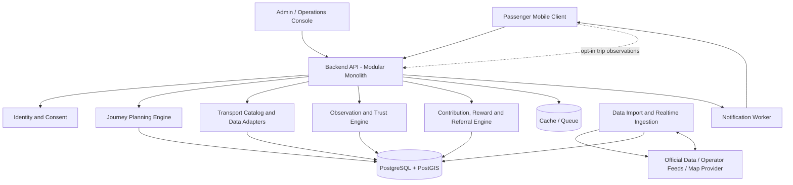
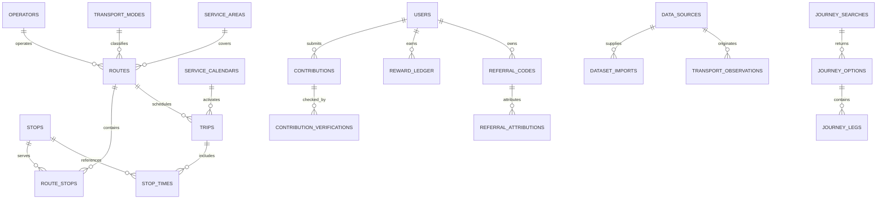

# Tunisia Mobility Platform — Software Design Document

**Document ID:** TUM-SDD-001  
**Version:** 0.8 — owner-authorized placeholder-based coding in parallel with data discovery
**Date:** 3 November 2026  
**Status:** Discovery in progress; working product baseline, not a final implementation contract  
**Product name:** Tunisia Unified Mobility Platform (working name)

## Authority and decision handling

This is the single current SDD. It consolidates the full v0.3 requirements with owner decisions and recommended defaults explicitly authorized on 3 November 2026. The current decision tables supersede conflicting status labels in retained historical text. Legal, factual and validation-dependent details remain TBD; no measurements, data sources, provider performance or legal findings are invented. Passenger-report classification D-06 is confirmed as feature-based Option C per the owner's latest instruction: basic reports and critical safety reporting remain accessible to guests, while advanced evidence/history features require an account. The v0.3 register's D-06 journey preferences remain confirmed separately; preserve both contextual IDs pending canonical ID assignment.

## Current owner-approved decisions

| Decision | Approved direction | Status / boundary |
|---|---|---|
| D-01 rollout | Greater Tunis → Sousse → Monastir → Sfax | Sequential, with readiness gates. |
| D-01b coverage | Verified transport-service areas | Validated routes, stops, stations and service areas; no blanket governorate claims. |
| D-45 mobile | React Native + Expo + TypeScript; premium custom visual standard | Confirmed; SDK/performance/design validation remains. |
| D-15 offline packages | Select city, region and modes independently | Confirmed; package and licensing details TBD. |
| D-15 freshness | Source-specific expiry rules and warnings | Confirmed; thresholds TBD. |
| D-69 billing | Monthly and yearly options | Confirmed direction; prices, provider and terms TBD. |
| D-69 extra benefits | Offline first; expand after research | Confirmed; no ad-free benefit approved. |
| D-16 route branches | Hybrid routes, variants, trip patterns and diversions | Confirmed direction; validate on real data. |
| D-26 vehicle matching | Multi-signal matching with confidence | Confirmed direction; accuracy gates TBD. |
| D-43 advertising | Contextual by default; personalization only by explicit opt-in | Confirmed; no default behavioral profiling. |
| D-46 backend | Python + FastAPI | Confirmed direction; details require validation. |
| D-47 database | PostgreSQL + PostGIS | Confirmed direction; schema/hosting validation remains. |
| D-48 maps | Open geographic data + managed tiles/routing where economical | Confirmed direction; provider/license/cost TBD. |
| D-49 hosting | Free development/early beta tiers; migrate when needed | Confirmed direction; production provider/ceiling TBD; no paid spend authorized. |
| D-50 offline storage | SQLite + versioned regional packages + cached map tiles | Confirmed direction; sync/entitlements/storage TBD. |
| D-54 moderation | Low-risk automation; human review for high-impact changes | Confirmed direction; thresholds/appeals TBD. |
| D-56 operator portal | Read-only first; managed capabilities after partnerships | Confirmed phased direction; scope TBD. |
| D-57 retention | Privacy assessment and qualified Tunisian legal review before collection | Process confirmed; retention periods TBD. |
| D-60 security | Staged baseline, threat modeling/code review, independent pre-launch penetration test | Confirmed direction; specialist release gates TBD. |
| D-06 report classification | Feature-based split (Option C) | Confirmed by the owner on 3 November 2026: basic reports and critical safety reporting are guest-accessible; advanced evidence/history requires an account. Detailed categories and moderation workflow still require specification. |

The v0.3 SDD body follows, with this table and section 32 authoritative wherever older statements conflict. The owner also authorized recommended defaults for the home screen (journey-first), accessibility (accessible-by-default), rural transport (verified service patterns only), and taxi availability (no unsupported current-availability claims). On 3 November 2026, the owner authorized modular application coding to proceed in parallel with transport-data research, using conspicuously labeled placeholder/demo states where evidence is unavailable. This does not authorize invented route, stop, timetable, fare, availability or coverage claims; real transport integrations and production rollout remain subject to data provenance, licensing, validation and the Phase 0 review. The visual palette remains exploratory, not an approved brand system.

## Owner-approved execution exception — 3 November 2026

- **Approved:** Continue coding the modular passenger application while the owner searches for transport data.
- **Allowed before Phase 0 exit:** Navigation, shared UI, localization, accessibility, screen flows and data-independent interactions. Use explicit empty/demo states that do not resemble verified transport facts.
- **Still gated:** Importing or publishing real transport records, presenting routes/stops/timetables/fares/vehicle availability or city coverage as facts, production routing, live integrations, location collection, monetization, deployment and public launch.
- **Data boundary:** Never invent transport content to make a screen look populated. A placeholder must be clearly labeled and must not be mistaken for a service claim.
- **Status:** Discovery and the source-data feasibility work continue in parallel with this limited implementation stream.

---
## 0. How to use this document

This is the consolidated v0.3 SDD, built from v0.1, v0.2 and the product-owner responses to the 71-question discovery questionnaire. It records confirmed product direction, proposes a system shape, and identifies decisions that must be resolved before production implementation.

The document is intentionally explicit about uncertainty. Coding agents must not convert an assumption into a fact, fabricate transport schedules, imply live GPS when none exists, or silently choose an unresolved product decision.

### Requirement language

- **MUST**: mandatory for the stated release or system behavior.
- **SHOULD**: expected unless a documented reason justifies a deviation.
- **MAY**: optional or future capability.
- **TBD**: requires a product, data, legal, UX or technical decision.

### Authority and change control

1. This SDD is the first shared source of truth for system behavior.
2. A later approved SDD revision supersedes earlier revisions.
3. Coding agents MUST read this document and the approved design constitution before implementation.
4. Agents MUST NOT invent brand tokens, production fares, operator integrations, route coverage, GPS feeds or booking partnerships.
5. Any change affecting product scope, data trust, privacy, money, journey ranking, or public transport facts must be recorded in the decision log and reflected in tests.


### 0.1 Current agreed product baseline (authoritative)

The following decisions were explicitly selected or stated by the product owner. They supersede older unresolved statements where they directly answer the same question. A decision marked TBD remains open and must not be silently inferred by an implementation agent.

| Area | Agreed direction | Status / boundary |
|---|---|---|
| Product | Tunisia-focused, free-to-use, community-powered, multimodal mobility platform | Confirmed |
| Launch geography | Greater Tunis → Sousse → Monastir → Sfax; verified transport-service areas | Confirmed; staged rollout and readiness gates |
| Pilot-city selection | Evaluate several cities using measurable criteria | Confirmed method; actual cities and scoring thresholds TBD |
| Geographic architecture | Multi-city support from the beginning | Required consequence of the selected rollout strategy |
| Passenger platform | Android first; React Native + Expo + TypeScript (D-45) | Confirmed; performance and platform validation remains |
| Future platforms | Preserve a path to iOS and web | Confirmed direction; timing and detailed scope TBD |
| Audience | Daily commuters and occasional travellers equally | Confirmed |
| Initial transport priorities | Buses and metro first | Confirmed priority; other modes remain in the domain model and activate progressively |
| Transport rollout | Represent all transport categories; activate each mode/area using its own requirements and verified data | Confirmed; exact activation thresholds TBD |
| Data strategy | Hybrid official data, community reports, voluntary GPS and operator integrations when available | Confirmed |
| Accounts | Guest-first; basic and critical safety reports are guest-accessible; advanced evidence/history is account-based | Confirmed under D-06; detailed workflows remain to be specified. |
| Launch languages | Arabic and French | Confirmed; English may be added later, timing TBD |
| Visual direction | Hybrid editorial identity + technical sophistication + approachable UX | Confirmed at direction level; exact identity and design tokens TBD |
| Home screen | Journey-first working default: journey search, nearby validated transport and relevant alerts; no location permission required | Confirmed working direction; detailed hierarchy needs UX validation |
| Accessibility | Accessible-by-default: RTL-correct Arabic, French, scalable text, screen-reader labels, sufficient contrast, usable touch targets, no color-only meaning, reduced motion | Confirmed working direction; formal checks and device/user validation remain |
| Main navigation | Context-aware navigation that changes with the current task | Confirmed; exact navigation model and screen IA still require UX design |
| Origin selection | Automatically detect current location, with manual override | Confirmed; permission-denied and location-unavailable behavior must be designed |
| Journey results | Adapt presentation to screen size and journey complexity | Confirmed |
| User-adjustable journey preferences | Budget, time and walking distance | Confirmed; do not add further passenger-facing filters without a decision |
| Waiting experience | Combine arrival prediction/confidence, simultaneous alternatives and an alert/live waiting mode | Confirmed, conditional on reliable data |
| Late/missed service recovery | Notify, suggest alternatives and allow recalculation | Confirmed; only trigger claims/recommendations when evidence supports them |
| Journey instructions | User-selectable simple and detailed views | Confirmed |
| Active journey | Combine trip progress, next-stop alerts and disruption recovery | Confirmed; location-based progress remains optional and permissioned |
| Saved journeys | Personal travel profiles with multiple routines | Confirmed; exact profile limits and sync rules TBD |
| Explore map | All available map layers with customizable filters | Confirmed; layer inventory and default filters TBD |
| Stop detail | Core first-view information: name, location and served lines | Confirmed; additional panels and their prioritization TBD |
| Place search | Arabic/French names, Latin transliterations, local aliases, spelling variants, suggestions and typo tolerance | Confirmed |
| Offline capability | Comprehensive offline experience intended to be available under a Pro plan | Confirmed product direction; exact offline feature matrix, technical model, plan terms and price TBD |
| Transport operating models | Mode-specific behavior; hybrid bus routes/variants/trip patterns/diversions confirmed; metro/rail behavior depends on data | Confirmed direction; detailed schemas and operating rules remain in transport specifications |
| Taxi collectif | Routes, pickup areas, fares and passenger-reported availability | Confirmed direction; availability remains observational unless independently verified |
| Louage | Stations, destinations, fares and approximate departure patterns | Confirmed direction; do not invent exact departure times |
| Rural transport | Verified distinct service patterns only; disclose unknown service facts | Confirmed working default; local data and operations validation remains |
| Fare transparency | Show fare information with source, date and confidence | Confirmed |
| Data activation | Different activation requirements for each transport mode | Confirmed; measurable thresholds TBD |
| Live information conflicts | Confidence-based reconciliation across available sources | Confirmed; source provenance must remain separately visible and no source is silently overwritten |
| GPS contribution | Optional automatic trip detection, only with explicit consent and transparent controls | Confirmed direction; technical feasibility and permission UX require prototype/legal review |
| GPS controls | Full consent and privacy dashboard | Confirmed direction; information architecture TBD |
| Vehicle matching | Multi-signal matching with confidence scoring | Confirmed direction; thresholds require field validation |
| Live vehicle display | Every displayed position carries confidence and source labels | Confirmed |
| Arrival predictions | Show a range, confidence and information source | Confirmed |
| Stale/conflicting reports | Expire stale data, reduce confidence and use moderation where needed | Confirmed |
| Community rewards | Mixed gamification and partner benefits | Confirmed; points, levels, partner benefits and budgets TBD |
| Community rankings | Separate leaderboard categories for reports, GPS and verified contributions | Confirmed; eligibility, privacy and ranking rules TBD |
| Referrals | Reward eligibility begins after the referred passenger completes their first journey search | Confirmed; definition of a qualifying search, caps and anti-fraud thresholds TBD |
| Individual taxi | Full discovery experience, with capabilities added progressively | Confirmed; no booking promise without verified partner confirmation |
| Taxi estimates | Combine tariff, distance/time, traffic and historical inputs according to source reliability | Confirmed direction; model, sources and confidence thresholds TBD |
| Taxi availability | No current availability claim without recent reliable evidence | Confirmed working default; evidence thresholds remain TBD |
| Taxi booking | Progressive booking capabilities only after partner, legal and operational validation | Confirmed; future capability, not a launch assumption |
| Advertising timing | Introduce advertising after sufficient transport coverage and passenger trust are established | Confirmed; measurable readiness thresholds TBD |
| Advertising formats | A useful, non-intrusive combination | Confirmed direction; exact formats TBD |
| Advertising placements | Several locations may be used, with strict frequency limits | Confirmed direction; exact surfaces and numeric caps TBD |
| Advertising personalization | Contextual by default; personalized only with explicit opt-in (D-43) | Confirmed; legal/privacy validation remains |
| Sponsored content | All sponsored content clearly labeled and never allowed to influence journey ranking | Confirmed; ranking firewall is mandatory |
| Monetization | Free core passenger access, later advertising, and a Pro direction for comprehensive offline functionality | Confirmed direction; Pro price, billing model and other entitlements TBD |
| Mobile framework | React Native + Expo + TypeScript (D-45) | Confirmed; device validation remains |
| Backend | Python + FastAPI (D-46) | Confirmed; detailed architecture validation remains |
| Database | PostgreSQL + PostGIS (D-47) | Confirmed; schema and operations validation remains |
| Maps | Free/open-source mapping first | Confirmed preference; exact provider, licensing and fallback TBD |
| Hosting | Free during development; low-cost production hosting | Confirmed budget direction; provider and spend ceiling TBD |
| Offline architecture | SQLite + versioned regional packages + cached map tiles (D-50) | Confirmed direction; sync/entitlements and licensing remain to design |
| Data integrations | Hybrid adapters, validation and automated data-quality monitoring | Confirmed |
| Administration | Administrator and moderator roles | Confirmed initial role structure; detailed permissions TBD |
| Dataset publishing | Safe updates may be auto-approved; major changes require manual review | Confirmed principle; safe-update criteria and rollback rules TBD |
| Community moderation | Low-risk automation and human review of high-impact changes (D-54) | Confirmed direction; thresholds and appeals remain to define |
| Passenger support | Ticketing with categories, statuses and escalation | Confirmed |
| Operator dashboard | Read-only first; managed capabilities after partnerships (D-56) | Confirmed phased direction; future scope remains |
| Location privacy | Privacy-by-design architecture, with qualified legal review | Confirmed direction; details and retention policy TBD |
| Account data | Collect minimum information; profile details optional | Confirmed |
| Consent presentation | One consent screen during onboarding | Confirmed UX preference; it must not be treated as blanket authorization for OS permissions or optional GPS collection |
| Security | Staged security baseline, threat modeling/code review and independent pre-launch penetration test | Confirmed direction; specialist controls/release gates require definition |
| Compliance | Documented compliance checklist with qualified local review | Confirmed |
| Beta audience | Daily commuters and university students | Confirmed |
| Initial mode priority | Buses and metro | Confirmed |
| City readiness | Measurable data-quality and passenger-testing thresholds required before declaring a city supported | Confirmed principle; thresholds TBD |
| Success metrics | Balanced dashboard for usage, trust, coverage and community health | Confirmed |
| Field testing | Structured tests covering journeys, disruptions, GPS and offline conditions | Confirmed |
| Expansion | Phased by demand, operator cooperation and measurable readiness | Confirmed |

### 0.2 Product-owner decisions versus recommendations

- **Confirmed** means explicitly selected or stated by the product owner.
- **Recommended** means a proposed direction that still requires acceptance or a technical decision record.
- **Delegated** means the product owner asked the architect or specialist to recommend an approach; it is not yet a selected implementation.
- **TBD** means unanswered, unverified, dependent on external evidence, or requiring professional review.
- **Inherited source finding** means a fact recorded in an earlier dated source audit; recheck it before implementation if freshness matters.

The owner-directed recommendation overlay in section 0 and the current Decision Register resolve the previously open product defaults for launch areas, home screen, accessibility baseline, rural transport, taxi availability, mobile/backend/database/offline stack, moderation and operator portal. Evidence-dependent thresholds, provider selection, legal review and detailed workflows remain open as listed in section 32.1.

### 0.3 Discovery status at this revision

The original 71-question answer record is historical input. Later owner decisions specify launch areas and selected technical directions; the owner's 3 November 2026 instruction also authorizes adopting recommended product defaults. Read section 0 and the active Decision Register for current status. Do not treat evidence-dependent, legal, numerical, or provider details as resolved.

---

# 1. Executive summary

The Tunisia Unified Mobility Platform is a passenger-first mobility information and journey-planning product. It helps people understand which transport to take, compare journey options, discover stops and lines, view schedules, assess how trustworthy transport information is, and contribute observations that improve the network for everyone.

The platform will model and progressively support:

- Urban, suburban and regional buses.
- Metro / light rail and related urban rail services.
- National, suburban and intercity trains.
- Taxi collectif.
- Louage.
- Rural and other shared road transport where verified data exists.
- Individual taxis, initially through discovery, estimated fares and travel-time information; booking may be introduced later through verified partners.
- Walking links between origins, stops, stations, transfers and destinations.

The journey planner will provide three distinct choices:

1. **Economic** — minimizes estimated total cost while respecting hard journey constraints.
2. **Fastest** — minimizes estimated door-to-door duration.
3. **Balanced / Recommended** — balances cost, duration, transfers, walking and reliability confidence.

The platform will launch Android-first across several selected Tunisian cities, with Arabic and French at launch. It will model every agreed transport category from day one while activating each mode and city only where verified data supports it. The platform will combine official/operator information, published schedules, community observations, opt-in trip-level location observations and derived predictions. These evidence types MUST remain distinguishable. A prediction must never be presented as a confirmed live arrival unless an appropriate live source supports that claim.

A mixed contribution and reward system will encourage high-quality data contributions and genuine community growth through points, levels, recognition, partner rewards when available, and referral rewards tied to meaningful activity rather than downloads alone.

## 1.1 Product thesis

**Help passengers make a better transport decision, then make the transport information more useful through verified community participation.**

## 1.2 Product principles

1. Passenger task first; transport-operator structure second.
2. Trust and provenance before apparent precision.
3. Nationally extensible data model; geographically phased launch.
4. Every transport mode has its own operating model.
5. Community data supplements official data; it does not silently overwrite it.
6. Privacy-preserving participation; no always-on GPS requirement.
7. Guest journey planning; account creation is reserved for personalized or contribution features.
8. The product must remain useful on slow connections and when live data is unavailable.
9. One coherent design system governs all implementation agents.

---

# 2. Problem statement and objectives

## 2.1 Passenger problems

Passengers commonly face three connected problems:

- **Route discovery:** they do not know which line, stop, station, direction or combination of modes gets them to a destination.
- **Schedule access:** they cannot easily find current, understandable departure and service information.
- **Operational uncertainty:** actual arrival and departure behavior may differ from published schedules, and passengers may not know whether a service is delayed, skipped, disrupted or unavailable.

Additional problems include fare uncertainty, confusing transfers, lack of stop-level information, poor network familiarity, and weak feedback loops between passengers and transport information providers.

## 2.2 Product goals

- G-01: Let a passenger search a journey from an origin to a destination without requiring registration.
- G-02: Present clear multimodal itineraries with steps, transfers, walking links, cost estimates and duration estimates.
- G-03: Explain why Economic, Fastest and Balanced options differ.
- G-04: Show transport information with explicit source, timestamp and confidence/freshness state.
- G-05: Support discovery of stops, stations, routes, service areas and transport modes.
- G-06: Collect useful passenger observations with safeguards against spam, duplication and coordinated manipulation.
- G-07: Allow voluntary, trip-scoped location contribution with clear consent and controls.
- G-08: Reward useful and verified contributions, and encourage referrals that produce genuine active users.
- G-09: Support Arabic (RTL) and French (LTR) at launch; keep localization architecture ready for English as a later addition.
- G-10: Expand across regions and operators without redesigning the core data model.

## 2.3 Non-goals for the first release

- N-01: Guaranteeing exact arrival times when no live feed or sufficiently strong evidence exists.
- N-02: Replacing transport operators' operational systems.
- N-03: Dispatching or booking individual taxis in the first release.
- N-04: Processing taxi payments, transport ticket payments or fare collection in the first release.
- N-05: Claiming nationwide coverage simply because the product data model is nationwide.
- N-06: Tracking users continuously or requiring GPS access to use the product.
- N-07: Treating a community report as an official operator announcement.
- N-08: Using AI-generated transport facts, invented timetables or synthetic GPS traces in production.
- N-09: Introducing advertising as a dependency for the first usable release. The passenger product is free to use; advertising is a later monetization phase.
- N-10: Allowing advertising or sponsorship to affect journey feasibility, route ranking, fares, service status, coverage, confidence or operator reliability.

---

# 3. Users and primary situations

## 3.1 Passenger groups

### P-01 Daily commuter

Uses recurring journeys for work, education or daily needs. Values saved journeys, fast access to favourite stops, reliable service information, disruption alternatives and notifications.

### P-02 Occasional traveller

May not know the network, line direction, stop names or transfer conventions. Needs guided instructions, understandable route steps, fare and duration estimates, and clear uncertainty labels.

### P-03 Passenger already waiting

Knows the route or stop but needs to understand whether the service is due, observed, delayed or uncertain. Needs fast stop search, line status, recent reports and alternatives.

### P-04 Passenger already travelling

Needs to confirm that they are on the correct route, know where to transfer or get off, and receive useful disruption information.

### P-05 Community contributor

Wants to improve route, timetable, stop or service information. Needs simple reporting, feedback on whether a contribution was accepted, transparent rewards and privacy controls.

### P-06 Transport data administrator

Reviews data imports, corrections, reports, operator information, service coverage, abuse signals and reward disputes.

## 3.2 Primary passenger situations

1. **Plan:** “How do I get there, and which option suits my budget or time?”
2. **Wait:** “Is my transport coming, and should I keep waiting?”
3. **Travel:** “Am I on the right service, and where do I get off?”
4. **Recover:** “The service did not appear or changed; what is my next-best option?”
5. **Contribute:** “I know what happened; how can I report it and help others?”

---

# 4. Scope and transport taxonomy

## 4.1 Transport modes in the domain model

All categories below MUST be representable in the domain model. Actual public availability is controlled by verified geographic and data coverage.

| Mode code | Mode | Required domain behavior | First-release stance |
|---|---|---|---|
| `BUS` | Urban / suburban / regional bus | Routes, stops, directions, scheduled trips, service calendars, fares where known, reports | Include wherever verified data exists |
| `METRO` | Metro / light rail | Lines, stations, directions, scheduled service, disruptions, transfers | Include where verified data exists |
| `TRAIN` | Rail / suburban / intercity train | Stations, trips, departure/arrival schedules, service notices | Include where verified data exists; SNCFT data ingestion is a validation dependency |
| `TAXI_COLLECTIF` | Taxi collectif | Defined route or service area, pickup/drop-off points, fare information, availability observations | Model separately; enable only in verified areas |
| `LOUAGE` | Louage | Departure stations, destinations, route/area, fare information, departure/seat observations when reliable | Model separately; enable only in verified areas |
| `RURAL_TRANSPORT` | Rural / other shared road transport | Stops/areas, route or destination, service days and fare information when available | Model separately; region-by-region |
| `INDIVIDUAL_TAXI` | Individual taxi | Pickup point, destination, estimated duration, estimated fare range and source | Discovery and estimates first; booking later |
| `TOURIST_TAXI` | Tourist taxi | Licensed service category, coverage and fare rules where verified | Represent separately; enable after legal/data review |
| `WALK` | Walking | Pedestrian connectors, access links, transfer paths and distance/duration estimates | Required journey-planning connector |

A future mode must be added through a documented mode configuration and adapter. Agents MUST NOT treat every mode as a bus route.

## 4.2 Operating-model distinction

- Scheduled fixed-route modes (bus, metro, train) use routes, stops/stations, trips, calendars and stop times.
- Shared / semi-scheduled modes (taxi collectif, louage, rural transport) may use routes, corridors, stations, operating areas, service patterns and observed departures. The model must permit incomplete schedules.
- Individual taxis are point-to-point services. The first release provides discovery and estimates, not dispatch or a booking promise.
- Walking is a connector, not a public transport operator.

## 4.3 Geographic strategy

**Decision: several Tunisian cities.** The launch sequence is Greater Tunis → Sousse → Monastir → Sfax, with verified transport-service-area coverage and readiness gates. The system MUST support multiple independent city networks from its first architectural version.

The platform is intended to represent the full Tunisian transport taxonomy from day one, but public availability is progressively enabled only in cities/modes for which the team has validated data and operating information. “All modes in the model” does not mean “all modes are live at launch.”

**Proposed pilot for evaluation:** Greater Tunis remains a candidate because the inherited v0.1 source audit records a TRANSTU GTFS catalogue entry for bus, metro and TGM schedules. This is a recommendation, not an approved city selection; the source package, current validity, licence and completeness must be rechecked.

The product MUST show a transparent “available / partial / unavailable” state by city, governorate, operator and mode. Do not show a blank or speculative nationwide map as if full coverage exists.

---

# 5. Core user experience requirements

## 5.1 UX information architecture (logical, not visual design)

The logical passenger areas are:

1. **Plan** — origin/destination search, journey results and trip details.
2. **Explore** — map, stops, stations, routes and service areas.
3. **Nearby / Stop** — nearby transport and a stop/station detail view.
4. **Contribute** — reports, schedule/stop corrections, trip contribution and contribution history.
5. **Profile** — saved journeys, preferences, language, privacy, rewards and referrals.

This is a logical information architecture, not a final visual design. Context-aware navigation that changes with the current task is selected. The adopted home-screen working default is journey-first: keep journey search, nearby validated transport and relevant service alerts easy to reach; confirm visual hierarchy and detailed transitions through UX validation. Android is the first passenger platform. The most frequent passenger action—finding or checking a journey—must remain immediately accessible. Daily commuters and occasional travellers are both primary audiences; journeys should support quick repeat use and guided first-time discovery.

## 5.2 Journey search flow

1. Passenger opens the app as a guest or authenticated user.
2. Passenger origin defaults to automatically detected current location after the relevant permission is granted; the passenger can manually override it using map selection, place search or a saved place. If location is denied or unavailable, the passenger can continue manually.
3. Passenger sets destination using place search, map selection or saved place. Search supports Arabic and French names, Latin transliterations, local aliases, spelling variants, suggestions and typo tolerance.
4. Passenger selects departure time or “leave now” and may adjust budget, time and walking distance. Do not expose additional passenger-adjustable filters without a further product decision.
5. Planner returns zero to three primary choices: Economic, Fastest and Balanced. It MUST return only choices supported by feasible candidates and MUST NOT manufacture alternatives merely to fill all three labels.
6. Each choice shows total estimated duration, total estimated fare/cost, transfers, walking distance, transport sequence and information confidence.
7. Passenger opens an option to see step-by-step instructions and line/station details.
8. Passenger may save or share the itinerary; login is requested only when necessary for persistent account features.

Acceptance criteria:
- Results never display an unqualified exact value when the system only has an estimate.
- Each itinerary step identifies the mode, operator/route where known, boarding point, alighting point and transfer instructions.
- Incomplete coverage produces a clear limitation, not a fabricated route.
- The passenger can compare all returned choices without opening each one.
- The result state handles zero, one, two or three available rankings without fabricated cards.
- Every multi-city search resolves its city/network context explicitly; it must not combine disconnected city graphs.

## 5.3 Three-choice journey ranking

### Economic
Primary objective: minimize total estimated monetary cost.

Constraints: the route must be feasible for the requested departure time and must meet configured safety/availability constraints. Walking and transfers are displayed; they are not hidden to make a cheap route appear attractive.

### Fastest
Primary objective: minimize estimated door-to-door elapsed time, including walking, waiting, transfers and in-vehicle time.

### Balanced / Recommended
Uses a documented configurable score over:
- Estimated door-to-door duration.
- Estimated total cost.
- Number of transfers.
- Walking distance/time.
- Reliability / evidence confidence.
- User preferences.

The initial weight values are TBD and must be configurable, versioned and tested. The ranking algorithm MUST expose the important factors contributing to a recommendation. It must not pretend the result is universally best for every passenger.

### Cost and time representation

- Currency: TND.
- Store monetary values as integer millimes (1 TND = 1,000 millimes) or a documented fixed-precision decimal; do not use binary floating point for money.
- Every fare has a source, validity period, coverage, and confidence status.
- Estimated taxi fare MUST be shown as a range when the model cannot justify an exact quote.
- Journey duration is represented in seconds internally; display is localized.

## 5.4 Transport detail / waiting flow

The selected core first view for a stop/station contains its name, location and served lines. Additional information such as direction, published schedules, recent observations, live vehicles, alerts and nearby alternatives may be provided in separate sections only after their UX priority and placement are specified. Any data that is displayed must retain its source, freshness and evidence label.

The UI MUST distinguish at least:
- `LIVE_OPERATOR` — current operator/system live feed.
- `LIVE_DEVICE_DERIVED` — current vehicle estimate inferred from multiple opt-in device observations and validated matching.
- `COMMUNITY_OBSERVED` — a time-stamped passenger report, not live tracking.
- `SCHEDULED` — published planned timetable.
- `PREDICTED` — a calculated estimate with displayed confidence and underlying evidence.
- `UNKNOWN` — no sufficiently reliable information.

A status must never be upgraded to `LIVE_OPERATOR` or `LIVE_DEVICE_DERIVED` just because a scheduled time is near.

## 5.5 During-journey flow

A passenger may open an itinerary and follow its steps. The app can show the current leg, next stop/transfer and an optional reminder. Location-based progress MUST be opt-in and must not require continuous background tracking for normal use.

## 5.6 Disruption and recovery flow

1. A passenger reports a missed, delayed, skipped or disrupted service, or the system receives an operator notice.
2. The report is stored as a time-stamped observation with its source and evidence.
3. Validation logic calculates a confidence state.
4. Affected journeys are recalculated only when enough evidence exists.
5. Passengers see the disruption's source, age and impact.
6. Alternative journeys are offered with their own confidence labels.

A single unverified report should not automatically mark an entire route as cancelled.

---

# 6. Data trust and source-of-truth model

## 6.1 Fundamental rule

Official data, community observations and derived intelligence are separate records. Never overwrite one with another.

### Evidence classes

| Class | Example | Authority | UI label requirement |
|---|---|---|---|
| Official static | Published route, timetable, fare, stop reference | Source-dependent | Official / published, plus source and date |
| Official live | Operator vehicle feed or service alert | High when authenticated and fresh | Live from operator, last received time |
| Community observation | Passenger reports a bus arrival | Observational; confidence depends on verification | Passenger report, time observed |
| Device observation | Opt-in trip-scoped GPS sample | Raw observation; must be matched and privacy-filtered | Contributed location data / estimated vehicle position |
| Derived prediction | Expected arrival or reliability score | Computed; quality depends on input data | Estimate / prediction, confidence and freshness |
| Curated correction | Admin-approved fix to route/stop/schedule metadata | Curated and auditable | Corrected/verified dataset with version and source |

## 6.2 Provenance fields

All imported data and relevant observations MUST retain:
- `source_id` and source name.
- `source_type`.
- `source_record_id` where available.
- `observed_at` or `published_at`.
- `ingested_at`.
- `valid_from` / `valid_until` where applicable.
- Dataset version or content hash.
- License / usage conditions.
- Geographic and operator coverage.
- Validation state and validation notes.

## 6.3 Freshness and expiry

Freshness is mode- and source-specific. Do not hardcode one universal expiry period for all transport categories.

A configurable freshness policy MUST define:
- Maximum age for live operator data.
- Maximum age for community arrival reports.
- Maximum age for GPS-derived position samples.
- Validity period for service disruption notices.
- Revalidation interval for static schedules and fares.

Expired observations remain in historical analytics if retention policy allows, but MUST NOT be displayed as current status.

## 6.4 Data quality and reconciliation

- Deduplicate imports using source identifiers and stable content fingerprints.
- Preserve raw imported files/snapshots and normalized records.
- Validate GTFS files against the GTFS specification before publication.
- Detect impossible coordinates, invalid time sequences, orphan stop references, duplicate trips and expired calendars.
- Human review is required for high-impact corrections until trust and automation are validated.
- Corrections must be versioned and reversible.

---

# 7. Community contribution, GPS and reward system

## 7.1 Contribution types

All listed contribution types are activated progressively as their data, moderation and verification requirements are met. The existing partial guest/account direction is recorded in the current overlay; report categories and the detailed boundary remain TBD under D-06.

- Confirm vehicle arrival/departure at a stop.
- Report that a vehicle passed without stopping.
- Report a missed service, delay, disruption or route change.
- Suggest a correction to a stop, line, direction, route or timetable.
- Confirm or contradict another report.
- Share location observations during an explicitly started trip.
- Contribute accessibility or stop-facility observations, subject to verification.

## 7.2 Contribution lifecycle

`SUBMITTED -> PENDING -> VERIFIED | REJECTED | EXPIRED | DISPUTED`

A contribution record MUST store:
- Contributor ID (or anonymous/guest token where allowed).
- Contribution type and affected transport entity.
- Claimed event time and server submission time.
- Approximate location or affected stop/route as required.
- Evidence type and optional supporting metadata.
- Verification method and verifier/validation event.
- Confidence score or verification class.
- Reward status and ledger reference.
- Abuse/rate-limit status.

## 7.3 Verification

Verification may use:
- Independent reports from different users.
- Consistency with route geometry and expected stop sequence.
- Consistency with timetable/service window.
- Operator feed or official notice.
- Trusted contributor history.
- GPS samples that plausibly match a route and vehicle movement.
- Human moderation for disputed or high-impact information.

Do not treat two reports from the same account, device or coordinated referral cluster as independent confirmations.

## 7.4 GPS contribution and privacy

Three conceptual modes:
1. **Normal use:** no location sharing beyond a permissioned one-time location lookup needed for the requested feature.
2. **Manual trip contribution:** the user explicitly starts a contribution session and can pause/stop it at any time.
3. **Optional automatic trip detection/contribution:** the product owner selected an optional automatic trip-detection experience, but it must require explicit, informed consent before any trip contribution starts. It is not permission for all-day tracking. Detection logic, background execution and OS permission behavior require a prototype and privacy/legal review.

Requirements:
- No all-day GPS tracking.
- No GPS permission required to use journey planning.
- Background location permission, if ever required, must have a clear purpose and separate consent.
- Show when contribution is active and when it has stopped.
- Allow pause, stop and consent revocation.
- Collect the minimum sampling precision/frequency necessary for a validated transport use case.
- Separate account identity from raw location samples where practical.
- Avoid storing a full personal movement history when derived transport observations are sufficient.
- Establish retention/deletion rules after privacy and legal review before production GPS collection.
- Never sell or publicly expose identifiable user movement traces.
- Do not award points simply for leaving GPS enabled; reward validated, useful transport observations.

## 7.5 Reward design

The selected strategy is **mixed**:
- Gamification: points, levels, badges, streaks or milestones, contributor recognition and carefully designed leaderboards.
- Tangible rewards: partner discounts, vouchers or benefits when verified partners and funding are available.

No tangible reward is promised until a signed/approved partner benefit exists.

The reward engine MUST use a ledger rather than directly mutating a user balance without history.

Proposed tables:
- `reward_rules` — versioned rule configuration.
- `reward_ledger` — append-only earn, reversal, expiry and redemption entries.
- `reward_balances` — cached balance derived from ledger.
- `contributor_levels` — thresholds and level definitions.
- `reward_redemptions` — partner benefit redemption, future capability.

Points are non-cash loyalty units unless a future approved policy explicitly defines otherwise. They must not be presented as money.

## 7.6 Referral rewards

The selected qualifying event is the referred passenger's **first completed journey search**. Installation or registration alone is insufficient.

The following remain TBD:
- What constitutes a completed/legitimate search (for example, successful result generation rather than opening the search screen).
- Attribution window and handling of multiple referral links.
- Reward value, cap and issuance delay.
- Whether account verification is required before reward credit.

Anti-abuse safeguards:
- One reward per eligible referral relationship.
- Idempotent reward issuance tied to the qualifying event.
- Rate limits and referral caps.
- Detect repeated account/device/contact patterns proportionately and transparently.
- Do not reward self-referrals or artificial/scripted searches.
- Hold suspicious rewards for review and support reversals.
- Do not collect invasive device fingerprinting solely to award points.

---

# 8. Individual taxi discovery and future booking

## 8.1 First-release taxi discovery

The selected direction is a full taxi-discovery experience with capabilities added progressively. The first release must not imply that a taxi is available or booked unless a verified source/partner confirms that state. The platform may display:
- Pickup location options.
- Destination.
- Estimated travel time/range.
- Estimated fare range and fare basis.
- Whether estimation is based on official tariff rules, distance/time model, traffic provider, or community observation.
- Clear statement that final fare may differ where applicable.

Individual taxi estimates must be isolated behind a fare-estimation adapter so tariff rules can be updated without changing journey-planning logic.

## 8.2 Booking evolution

The selected strategy is **both, progressively**:
- Release 1: taxi discovery and fare/time estimates using available, supportable information; progressively add discovery details as sources are validated, with no direct dispatch or booking promise.
- Later release: booking requests through verified taxi partners after legal, operational, driver verification, support, cancellation and payment requirements are resolved.

Future booking MUST use verified partner and driver records, explicit booking states, a clear cancellation policy, support escalation, audit history and secure payment design if payments are added.

---

# 9. Proposed system architecture

## 9.1 Architectural style

**Recommendation: modular monolith for the initial system, with clear domain boundaries and asynchronous workers.**

The product has interconnected domains and uncertain data access. Starting with a distributed microservice architecture would add operational complexity before scale or team structure justifies it.

The design MUST keep domain modules separately testable and allow later extraction of high-load components such as routing, real-time ingestion or notifications.

## 9.2 Logical components

| Component | Responsibility |
|---|---|
| Android-first passenger client | Journey search, map/explore, stop details, reports, saved journeys, consent and rewards; keep domain/API contracts platform-neutral for later clients |
| Web admin / operations console | Dataset imports, data quality, moderation, operator/source management, reward review and coverage configuration |
| API application | Authentication, passenger APIs, domain orchestration, authorization and validation |
| Journey engine | Multimodal graph search, itinerary generation, three ranking strategies and explanations |
| Transport data adapters | GTFS, CSV/XLSX, official open data, operator APIs and partner feeds |
| Realtime ingestion | Receive operator feeds and opt-in observations; normalize and validate them |
| Observation and trust engine | Verification, confidence calculation, expiry and reconciliation |
| Reward/referral engine | Contribution scoring, append-only reward ledger, referral eligibility and abuse review |
| Notification worker | Disruption, saved journey and contribution/reward notifications |
| Primary database | Relational source of truth, spatial data and audit records |
| Cache / queue | Hot route data, rate limits, queues and asynchronous jobs where needed |
| Mapping/routing provider adapter | Base maps, geocoding, walking paths and optional road travel-time inputs |
| Analytics pipeline | Aggregated reliability and service-quality metrics without unnecessary personal data |

## 9.3 Proposed high-level diagram



## 9.4 Deployment topology

Initial deployment should use:
- One API application deployment.
- One background worker deployment/process.
- One relational database with spatial extension.
- Optional cache/queue, introduced when needed for workloads or rate limits.
- Object storage for raw data imports and versioned source snapshots.
- Separate admin access and authorization roles.

No provider-specific infrastructure is finalized in v0.1.

## 9.5 Owner-confirmed stack baseline and remaining choices

| Layer | Candidate / preference | Status / reason |
|---|---|---|
| Passenger app | React Native + Expo + TypeScript (D-45) | Owner-confirmed; validate Android GPS, push, offline/Pro, low-end-device and distribution needs while preserving future iOS path |
| Web/admin | React/TypeScript | Candidate only; not selected |
| Backend | Python + FastAPI | Owner-confirmed D-46; detailed architecture validation remains |
| Database | PostgreSQL + PostGIS | Owner-confirmed D-47; schema/operations validation remains |
| Queue/cache | Redis-compatible service or managed queue | Add only when justified |
| Routing | Dedicated routing engine/library behind adapter | Select after data and routing prototype |
| Maps/geocoding | Free/open-source mapping first; provider adapter and fallback strategy | Preference confirmed; exact tile/geocoding provider, licenses, offline terms and Tunisia quality TBD |
| Hosting | Free development infrastructure and low-cost production hosting | Budget direction confirmed; provider, limits, data region and monthly ceiling TBD |
| Offline/Pro storage and synchronization | SQLite + versioned regional packages + cached map tiles (D-50) | Owner-confirmed direction; entitlement, synchronization, storage limits, licensing and freshness details remain to design |

The owner has confirmed the mobile, backend, database and offline starting directions. Coding agents must preserve those choices and create the required ADRs before scaffolding; provider choices, operational details and cost/license checks remain Phase 0 work. Do not select a web/admin framework or routing provider without a separate evidence-backed decision.

---

# 10. Data model (logical baseline)

## 10.1 Core entities

### Identity and user

- `users`: id, display_name, email/phone (nullable and verified as appropriate), preferred_language, status, created_at, updated_at.
- `user_preferences`: user_id, budget constraint, time constraint, walking-distance constraint, travel-profile references and notification preferences. Do not expose max-transfers, preferred-modes or accessibility filters as passenger controls until separately approved; the schema may be extended later.
- `user_consents`: user_id, consent_type, version, granted_at, revoked_at, device/session context.
- `user_saved_places`: user_id, label, coordinates/place reference.
- `user_saved_journeys`: user_id, origin/destination references, preference snapshot.

### Operator and network catalog

- `operators`: id, name, operator_type, official identifiers, status, contact/source metadata.
- `transport_modes`: code, display labels, behavior configuration.
- `service_areas`: id, name, governorate/delegation, geometry, coverage_status.
- `stops`: id, source IDs, name by language, stop_type, coordinates, accessibility/facility attributes, verification_status.
- `routes`: id, operator_id, mode_code, short_name, long_name, direction metadata, geometry, service_area_id, active status.
- `route_stops`: route_id, stop_id, sequence, pickup/dropoff rules.
- `trips`: id, route_id, service_calendar_id, direction, headsign, source reference.
- `stop_times`: trip_id, stop_id, sequence, arrival_time, departure_time.
- `service_calendars`: service days, start_date, end_date and exceptions.
- `fare_rules`: mode/operator/route/zone, amount_millimes or range, source, valid_from, valid_until, confidence.
- `transport_stations`: may share the `stops` base entity with station-specific attributes; do not duplicate geographic primitives without a reason.

### Shared transport and taxi-specific entities

- `service_patterns`: mode-specific route/corridor/destination pattern where fixed schedules do not exist.
- `boarding_points`: validated pickup/departure points linked to a stop or service pattern.
- `service_departure_observations`: observed or published departures for louage/shared modes.
- `taxi_estimate_requests`: origin, destination, estimate result, model/source version and timestamp; retain only as long as product analytics and privacy policy justify.
- `taxi_partners` and `taxi_drivers`: future booking capability; not required for first release.
- `taxi_bookings`: future capability only; do not implement in first release.

### Data provenance and observations

- `data_sources`: name, type, owner, license, usage terms, access method, update expectation, active status.
- `dataset_imports`: source_id, dataset_version, content_hash, imported_at, validation_state, raw_file_location, import summary.
- `transport_observations`: generic observed event, entity reference, event_type, observed_at, submitted_at, source_id, contributor_id nullable, geometry/location, status, confidence and expiry.
- `gps_observation_sessions`: user_id, started_at, ended_at, consent_id, session state; trip-scoped only.
- `gps_observations`: session_id, timestamp, coarse/precision-controlled location, accuracy, derived_match_state; apply minimization and retention policy.
- `service_alerts`: source, affected entity(s), severity, start/end, message translations, validation state.
- `data_corrections`: proposed change, previous value, proposed value, reviewer, status, audit metadata.
- `verification_events`: observation_id, verification method, corroborating references, result, reviewer/system version.

### Journey planning

- `journey_searches`: origin/destination, departure/arrival intent, preferences snapshot, requested_at; use anonymous session IDs where possible.
- `journey_options`: search_id, ranking_type, cost range, duration range, transfers, walking, confidence, algorithm_version.
- `journey_legs`: option_id, mode, route/trip/service_pattern reference, boarding/alighting points, timing and evidence references.
- `routing_versions`: graph/dataset snapshot, algorithm version, deployment date.

### Community and rewards

- `contributions`: contributor, type, payload/reference, submitted_at, status, quality score, moderation state.
- `contribution_verifications`: contribution_id, verifier/evidence reference, method, result, created_at.
- `reward_rules`: rule key, version, points, conditions, cap, valid period.
- `reward_ledger`: user_id, contribution/referral/redemption reference, entry_type, points_delta, status, created_at, reversal_of nullable.
- `reward_balances`: user_id, derived/cached available points, updated_at.
- `contributor_levels`: level key, thresholds, benefits/visual badge metadata.
- `referral_codes`: user_id, code, active status, cap and validity.
- `referral_attributions`: referrer, referred user, code, created_at, qualifying event, reward status, abuse review.
- `reward_partners`: future partner metadata and approved benefit definitions.
- `reward_redemptions`: future voucher/benefit redemption history.

### Operations and audit

- `admin_roles` / `permissions`.
- `moderation_cases`.
- `audit_logs` (append-only for sensitive admin and reward operations).
- `notification_jobs` and `notification_preferences`.

## 10.2 Data relationships (simplified)



## 10.3 Database constraints and indexing

- Use UUID or another stable opaque primary key for application entities.
- Preserve external source IDs in source-scoped unique constraints.
- Use PostGIS geometry/geography types with SRID 4326 for source coordinates; validate coordinate bounds.
- Add spatial indexes for stops, service areas, route geometries and observations.
- Add indexes for route/operator/mode, trip/service date, stop/time, observation entity/time/status, contribution status, reward ledger user/time and referral attribution.
- Store timestamps in UTC; interpret service timetable local times using `Africa/Tunis` and the source's calendar semantics. Do not assume all GTFS service times are ordinary 00:00–23:59 wall-clock values.
- Use integer millimes for TND amounts.
- Use foreign keys and explicit deletion/anonymization policies.
- Use append-only or immutable audit history for reward ledger, source imports and admin actions.
- Enable row-level/security policies if a backend platform uses database-level access controls; never rely only on client-side authorization.

---

# 11. Journey engine and routing requirements

## 11.1 Network representation

Represent the transport system as a time-dependent multimodal graph:
- Nodes: stops, stations, pickup points, destinations and transfer connectors.
- Edges: walking connectors, scheduled vehicle legs, service-pattern legs and eligible taxi legs.
- Edge attributes: mode, operator, fare, time estimate, schedule, accessibility, availability, evidence class and confidence.

## 11.2 Routing constraints

- Respect direction and service calendars.
- Account for departure time, waiting time, transfers and walking.
- Do not create a transfer between geographically nearby but operationally disconnected stops unless a walk connector is validated.
- Respect mode-specific pickup/drop-off rules.
- Use only services marked active for the chosen time/area.
- Mark routes containing incomplete or uncertain service data.
- Allow route results to be partial where full-network data is unavailable, with a clear explanation.

## 11.3 Algorithm evolution

Release 1 should prefer a proven time-dependent transit routing engine or library, adapted through an internal interface. Do not build an untested custom graph engine unless the prototype proves existing engines cannot support required Tunisian modes.

Use multi-criteria post-ranking to produce Economic, Fastest and Balanced choices. Record `algorithm_version` and relevant dataset version with each result for debugging and reproducibility.

## 11.4 Journey result data contract

Each option should return at minimum:

```json
{
  "option_id": "opaque-id",
  "ranking_type": "ECONOMIC | FASTEST | BALANCED",
  "departure_at": "ISO-8601 datetime with offset",
  "arrival_at": "ISO-8601 datetime with offset",
  "duration_seconds": 2100,
  "cost": {
    "currency": "TND",
    "min_millimes": 2500,
    "max_millimes": 3000,
    "confidence": "ESTIMATED",
    "source_summary": "source-specific explanation"
  },
  "transfer_count": 1,
  "walking_distance_meters": 450,
  "confidence": "PARTIAL",
  "legs": [],
  "explanation_codes": ["LOWER_COST", "ONE_TRANSFER"],
  "algorithm_version": "journey-ranker-v1"
}
```

This is an illustrative contract. Exact types, nullable behavior and OpenAPI schemas must be finalized with the chosen stack.

---

# 12. API baseline

All APIs are versioned under `/api/v1`. JSON is the default response format. All inputs MUST be validated server-side. Lists must support pagination or bounded result sizes. Consistent errors use `{ "error": { "code": "...", "message": "...", "details": {} } }`.

| Method | Endpoint | Purpose | Auth |
|---|---|---|---|
| GET | `/api/v1/coverage` | Available regions, operators and modes | Guest |
| GET | `/api/v1/modes` | Transport categories and localized labels | Guest |
| GET | `/api/v1/stops/nearby` | Search nearby stops/stations | Guest; location permission handled client-side |
| GET | `/api/v1/stops/{stopId}` | Stop detail and served routes | Guest |
| GET | `/api/v1/routes/{routeId}` | Route detail, direction, geometry and stops | Guest |
| GET | `/api/v1/routes/{routeId}/departures` | Published/observed departure information | Guest |
| POST | `/api/v1/journeys/search` | Multimodal journey search | Guest |
| GET | `/api/v1/journeys/{optionId}` | Journey option detail | Guest/session owner |
| POST | `/api/v1/reports` | Submit passenger report | Auth or controlled guest token; policy TBD |
| POST | `/api/v1/reports/{reportId}/confirmations` | Confirm/dispute a report | Auth or controlled guest token; policy TBD |
| POST | `/api/v1/contributions/schedule-corrections` | Suggest schedule/route/stop correction | Auth |
| POST | `/api/v1/trip-contributions/sessions` | Start opt-in trip contribution | Auth + current consent |
| POST | `/api/v1/trip-contributions/sessions/{id}/observations` | Submit location observation | Auth + active session |
| POST | `/api/v1/trip-contributions/sessions/{id}/stop` | End contribution session | Auth + owner |
| GET | `/api/v1/me/rewards` | Reward balance, levels and history | Auth |
| GET | `/api/v1/me/referral` | Referral code and eligible activity | Auth |
| GET | `/api/v1/me/saved-journeys` | Saved journeys | Auth |
| POST | `/api/v1/me/saved-journeys` | Save a journey | Auth |
| GET | `/api/v1/service-alerts` | Current service alerts in a region | Guest |

Admin-only endpoints must be separated by role and are not exhaustively defined here. Never expose raw user GPS observations or moderation controls through public endpoints.

## 12.1 API behavior requirements

- Use idempotency keys for contribution submission where retrying could create duplicate reports.
- Apply per-user, per-device/session and IP-aware rate limits proportionately.
- Validate coordinates, timestamps, referenced route/stop IDs and allowed contribution types.
- Return the evidence class, freshness timestamp and confidence state with arrival/status responses.
- Use pagination for reports, reward history and admin queues.
- Never send provider secrets, private user data or raw GPS traces to the client.

---

# 13. External data and integration strategy

## 13.1 Source audit findings (as checked 3 November 2026)

The following public catalogue entries are useful starting points, not proof that all required data is current, complete or operationally reusable:

| Source | Catalogue information observed | SDD consequence |
|---|---|---|
| TRANSTU GTFS | Dataset describes planned bus, metro and TGM schedules/routes/stations; listed as modified 25 January 2026; OTL licence shown | Candidate static timetable/route import for Greater Tunis; validate actual ZIP, completeness, service dates and licence conditions |
| SNTRI bus schedules | CSV and XLSX schedule resources listed; dataset modified 25 January 2026; OTL licence shown | Candidate intercity bus timetable input; validate fields, geographic completeness and update process |
| SNCFT GTFS | A SNCFT rail GTFS catalogue entry exists, but the page currently states that the dataset is empty | Do not depend on SNCFT GTFS until a usable file/feed is obtained and validated |
| National stop reference | Dataset describes national land-transport stops including bus, train, taxi and louage, with coordinates and selected facilities; listed modified 10 March 2026 | Candidate national stop reference; verify coverage, field quality, access and attribution requirements |
| Irregular/shared transport listing | Catalogue describes louage (blue-band), rural transport and taxi collectif route/approval information for some governorates | Useful seed/reference information only; do not interpret it as complete passenger timetables or all-country service availability |
| SAEIV procurement | A public tender dated 20 October 2026 concerns acquiring/implementing an operations assistance and passenger information system for national/regional land transport companies | Monitor as a potential future integration opportunity; procurement notice does not prove deployment or feed availability |

Official/primary catalogue links:
- TRANSTU GTFS: https://catalogue-data.transport.tn/dataset/horaires-des-voyages-de-la-transtu-gtfs
- SNTRI schedules: https://catalogue-data.transport.tn/dataset/sations-lignes-d-exploitation-et-horaires-des-bus-de-la-sntri
- SNCFT GTFS listing: https://catalogue-data.transport.tn/dataset/horaires-du-reseau-ferre-de-la-sncft-gtfs-gtfs
- National stop reference: https://catalogue-data.transport.tn/dataset/referentiel-national-d-arret
- Shared / irregular transport catalogue: https://catalogue-data.transport.tn/dataset/?groups=transport-terrestre&res_format=ZIP
- Ministry SAEIV notice: https://www.mtc.gov.tn/index.php?L=%2F&cHash=de75fc5239cc918fbec9b20646ccd3ea&id=291&tx_ttnews%5Btt_news%5D=5218
- Transport portal tender listing: https://www.transport.tn/onpft/listoffre/

## 13.2 Integration adapters

Create one adapter per source format/provider:
- `GtfsStaticAdapter` for validated GTFS static feeds.
- `CsvScheduleAdapter` and `XlsxScheduleAdapter` for timetable files.
- `NationalStopsAdapter` for the stop reference.
- `SharedTransportCatalogAdapter` for route/permit reference data.
- `OperatorRealtimeAdapter` for a future authenticated live API/feed.
- `MapProviderAdapter` for geocoding, tiles and walking/road travel-time inputs.

Adapters MUST normalize data into the internal model without leaking vendor-specific field names into business logic.

## 13.3 Import pipeline

1. Fetch or upload a source dataset.
2. Store the original raw file and metadata.
3. Calculate content hash and dataset version.
4. Validate file format, schema, required tables and license metadata.
5. Run structural and geographic quality checks.
6. Normalize records into staging tables.
7. Produce an import report with warnings and rejected rows.
8. Approve and publish a versioned dataset.
9. Invalidate relevant caches and routing graph snapshots.
10. Retain rollback path to the prior published version.

No data feed may be scraped or reused in production until its terms, stability and access method have been reviewed.

---

# 14. Security, privacy and abuse prevention

## 14.1 Security baseline

- Use a maintained authentication provider or a correctly implemented passwordless/password authentication flow; never store plaintext passwords.
- Use role-based authorization for admin, moderator, operator and passenger functions.
- Require server-side authorization checks for all account, contribution, reward and admin resources.
- Protect sensitive actions with re-authentication where appropriate.
- Encrypt traffic in transit and use managed encryption at rest where available.
- Store secrets only in server-side secret management/environment configuration.
- Apply request validation, rate limiting, CSRF protection where cookie sessions are used, and secure session handling.
- Maintain audit logs for administrator changes, reward adjustments, data publication and moderation.
- Back up the database and test restoration.

## 14.2 Privacy baseline

- Guest route search should work without requiring an account.
- Present a consolidated privacy/consent explanation during onboarding, as selected by the product owner.
- A single onboarding screen MUST NOT be interpreted as blanket permission for OS location access, background location, notifications or optional trip contribution. Obtain any required feature-specific/OS permission when the relevant feature is activated, and make revocation available.
- Separate one-time location lookup consent from trip contribution consent.
- Store consent version and timestamps.
- Provide access to active GPS contribution state and a clear stop control.
- Minimize exact location precision and retention.
- Provide account data export/deletion workflows as legally and technically applicable.
- Complete a privacy/legal review of Tunisian data-protection requirements before collecting persistent or background location data.

## 14.3 Abuse and integrity

- Detect duplicate/spam reports.
- Prevent one contributor from confirming their own report as independent evidence.
- Apply rate limits and risk scoring to repeated contradictory reports.
- Require review for high-impact schedule, route or fare changes.
- Maintain append-only reward accounting and reversal entries.
- Delay suspicious referral and reward credits until eligible activity is verified.
- Provide moderation appeal/dispute status.

---

# 15. Non-functional requirements

These are initial targets for validation, not measured existing capabilities. The launch team must revise them after selecting the stack, provider and target geography.

## 15.1 Performance

- NFR-PERF-01: For cached/common reads, target API p95 <= 500 ms under agreed pilot load, excluding external provider latency.
- NFR-PERF-02: Journey search target p95 <= 3 seconds for the pilot network under agreed load and data size.
- NFR-PERF-03: Nearby stop search target p95 <= 1 second for ordinary query radii under agreed load.
- NFR-PERF-04: UI must indicate loading and allow cancellation/retry; it must not freeze while routing or map data loads.

## 15.2 Availability and resilience

- NFR-REL-01: Journey discovery and static schedules should remain usable when live feeds are unavailable.
- NFR-REL-02: Cache last-known static network data safely, with visible data timestamp and offline/stale indicators.
- NFR-REL-03: External provider failures must not crash core app flows.
- NFR-REL-04: Background imports and notifications must be retryable and idempotent.
- NFR-REL-05: Define backup schedule, RPO and RTO before public launch (TBD).

## 15.3 Accessibility and localization

- NFR-UX-01: Support Arabic RTL and French LTR at launch, including numerals, dates, directions and map controls. Keep localization architecture ready for English later; do not display incomplete English translations as complete.
- NFR-UX-02: Text and controls must meet an agreed WCAG 2.2 AA target where applicable.
- NFR-UX-03: Touch targets should be comfortable for mobile use and must not rely on color alone to communicate status.
- NFR-UX-04: Map and route information must have a textual/list equivalent.
- NFR-UX-05: Support reduced-motion settings and readable contrast outdoors.

## 15.4 Connectivity and device constraints

- NFR-CONN-01: Core online passenger functionality should minimize payload and support slow mobile networks.
- NFR-CONN-02: Comprehensive offline functionality is intended as a Pro-plan entitlement, based on previously downloaded/cached data. The full feature matrix, synchronization behavior, download limits and Pro terms are TBD.
- NFR-CONN-03: Offline displays must show the age and source of cached data. Offline operation cannot create current live operator updates or guarantee real-time arrivals while disconnected.
- NFR-CONN-04: Offline availability is subject to data licensing, device storage, local data completeness and a defined freshness policy.
- NFR-CONN-05: GPS contribution must pause or queue safely when connectivity is lost, subject to explicit consent and retention rules; queued samples must not be submitted after consent/session revocation.
- NFR-CONN-06: Do not assume high-end device performance or persistent background execution.

## 15.5 Observability

Track service-level indicators without collecting unnecessary passenger data:
- API latency and error rates.
- Journey search completion and no-route rate.
- Dataset import success and validation warnings.
- Age/freshness of each source/feed.
- GPS contribution pipeline rejection and matching rates.
- Contribution verification rate and dispute rate.
- Reward ledger reconciliation errors.
- Referral abuse rate.

---

# 16. Functional requirements and acceptance criteria

| ID | Requirement | Priority | Acceptance criteria |
|---|---|---|---|
| FR-001 | Guest origin/destination search | MUST | Given a guest, when they provide valid origin and destination, then they can request journeys without registration |
| FR-002 | Coverage-aware transport catalog | MUST | Given a region/mode, when coverage is queried, then the API returns supported, partial or unavailable with source/update metadata |
| FR-003 | Multimodal journey results | MUST | Given validated network data, when a journey is requested, then feasible routes include mode changes and explicit transfer/walking legs |
| FR-004 | Economic / Fastest / Balanced options | MUST | Given at least two feasible alternatives, then the result set explains cost, duration, transfers, walking and confidence for each available ranking |
| FR-005 | Scheduled vs live distinction | MUST | Given a stop or route, when information is shown, then each result has evidence class and last-updated time |
| FR-006 | Stop and route detail | MUST | Given a known stop/route, then name, location, served services and available schedule/observations are displayed |
| FR-007 | Passenger service reports | SHOULD | Given an authenticated/eligible reporter, when they submit a valid event, then it is stored as pending observation and not automatically treated as official truth |
| FR-008 | Report confirmation/dispute | SHOULD | Given a report, when independent users confirm or dispute it, then verification state and confidence are recalculated with audit history |
| FR-009 | Schedule/stop correction proposals | SHOULD | Given a contributor, when they suggest a correction, then the existing official/source record remains unchanged until review/publication |
| FR-010 | Trip-scoped GPS contribution | SHOULD | Given explicit consent and an active session, when location observations are submitted, then they are tied to the session and can be stopped/revoked |
| FR-011 | Reward ledger | SHOULD | Given an eligible verified contribution, when rewards are issued, then an immutable ledger entry is created exactly once |
| FR-012 | Mixed reward levels | SHOULD | Given a user balance and level rules, then the user can see points, progression and available partner benefits without misrepresenting points as cash |
| FR-013 | Active-user referrals | SHOULD | Given a referral, when the referred user meets the qualifying activity and anti-abuse checks, then eligible rewards are issued once |
| FR-014 | Individual taxi estimates | SHOULD | Given origin/destination and available fare model, then an estimated range and basis are shown; no booking is implied |
| FR-015 | Shared transport modes | SHOULD | Given validated service pattern data, then taxi collectif, louage and rural/shared transport can be searched without being modeled as scheduled buses |
| FR-016 | Saved journeys | COULD | Given a signed-in user, when they save a route, then it appears in their saved list |
| FR-017 | Disruption notifications | COULD | Given a saved journey and verified relevant alert, then a notification is sent according to user preferences |
| FR-018 | Taxi partner booking | WON'T for first release | No direct taxi dispatch/booking until partner, legal and operational requirements are approved |
| FR-019 | Operator live vehicle feed | DEPENDENCY | If an authorized feed exists and passes freshness checks, then live positions are displayed with operator-source provenance |

---

# 17. Admin and operations requirements

A functional platform needs internal tools, not only a passenger application. The web admin/operations console is required operational infrastructure, even if its capabilities are delivered progressively.

The initial human role model includes **administrator** and **moderator** roles. Fine-grained permissions and separation of duties remain to be specified. The operations console SHOULD support:
- View coverage by governorate/operator/mode.
- Upload and validate GTFS/CSV/XLSX datasets.
- Compare import versions and roll back published data.
- Inspect rejected rows and validation warnings.
- Manage sources, licenses and update cadence.
- Review disputed or high-impact passenger reports.
- Approve/reject schedule, stop and route correction proposals.
- Inspect reward ledger entries and reverse erroneous rewards with audit records.
- Review suspicious referrals and contributor abuse patterns.
- Configure route/arrival freshness policies and ranking weights with version history.
- Publish localized service alerts.
- Provide passenger-support ticketing with categories, statuses and escalation.
- Auto-approve only update classes explicitly designated safe by versioned validation rules; route major/high-impact dataset changes to manual review. The safe-update criteria remain TBD.

A separate transport-operator dashboard is undecided and must not be built as an assumed launch requirement.

Admin actions that affect public transport facts, fares, rewards or user consent records MUST be auditable.

---

# 18. Delivery roadmap

## Phase 0 — Discovery and feasibility (before implementation)

Deliverables:
- Evaluate the four confirmed rollout areas using measurable transport-data quality, passenger demand, operator cooperation and field validation. Keep the network model multi-city from day one.
- Inspect and test actual TRANSTU, SNTRI, stop-reference and shared-transport datasets.
- Confirm licences, reuse conditions and source update patterns.
- Attempt to obtain or verify SNCFT data; do not assume catalogue presence means usable feed.
- Identify operator contacts and possible data agreements.
- Test map/geocoding providers for Tunisia coverage and cost.
- Recommend the Android-first delivery approach; framework is confirmed as React Native + Expo + TypeScript. Validate trip-scoped/optional automatic GPS contribution, push notifications, low-end-device performance and Pro offline requirements; preserve a future iOS path.
- Finalize product UX journeys and design constitution.
- Have the technical architect recommend the stack, hosting and budget after feasibility tests.
- Define advertising guardrails, but do not integrate ads into the MVP. Advertising readiness depends on sufficient transport coverage and passenger trust.
- Define the Pro offline entitlement and commercial terms before implementation; the user has selected full offline functionality as a Pro-plan benefit, but exact plan terms remain TBD.

Exit criteria: a validated pilot dataset and a feasible end-to-end journey-planning prototype using real, attributed data.

## Phase 1 — Transport foundation MVP

- Prioritize validated bus and metro coverage in the chosen pilot city/cities.
- Application shell and localization foundations.
- Coverage-aware transport catalog.
- Data import pipeline and admin validation tools.
- Stop/route search and detail.
- Initial multimodal journey planning over the validated pilot network.
- Economic, Fastest and Balanced ranking.
- Scheduled information with source/date labels.
- Guest access and saved journeys only if needed for pilot.

Exit criteria: passenger can plan and understand an end-to-end pilot journey from real validated source data without seeing fabricated live status. Initial beta testing must include daily commuters and university students.

## Phase 2 — Community reliability

- Passenger arrival/departure and disruption reports.
- Report verification, expiry and moderation.
- Report confirmation/dispute.
- Data-quality and freshness dashboards.
- Nearby alternatives for sufficiently verified disruptions.

Exit criteria: reports can be submitted, validated, expired and displayed with correct provenance and without corrupting official schedules.

## Phase 3 — Opt-in contribution and rewards

- Explicit trip-contribution consent and session controls.
- Location observation matching prototype.
- Contribution quality scoring.
- Reward ledger, levels and badges.
- Referral program tied to qualified active users.
- Anti-abuse review tools.

Exit criteria: contribution and reward flows are privacy-reviewed, fraud-tested and auditable. GPS-derived vehicle positions are shown only after matching-quality thresholds are met.

## Phase 4 — Broader mobility and partner integrations

- Expand only after measurable city data-quality and passenger-testing gates are met; use a phased sequence based on demand, operator cooperation and readiness.
- Extend validated bus/rail/shared transport networks by region and selected city.
- Individual taxi estimate improvement.
- Verified taxi partner onboarding and booking discovery.
- Operator integrations and live feeds where authorized.
- Tangible reward partners.
- Evaluate and introduce clearly labeled advertising only after passenger trust, policy, privacy and placement decisions are approved; ads remain independent of journey ranking.

Exit criteria: each new geography/mode has a documented source, coverage status, quality checks, support model and user-facing uncertainty behavior.

---

# 19. Test strategy

## 19.1 Data tests

- Validate GTFS tables, foreign keys, stop coordinates, service dates and time semantics.
- Reject empty, malformed or expired datasets from publication.
- Test duplicate imports and rollback.
- Test route geometry and stop order consistency.
- Test source provenance preservation.

## 19.2 Journey engine tests

Use deterministic fixtures with known expected options.

Test:
- No service on requested date/time.
- One-leg and multi-leg journeys.
- Transfers with sufficient and insufficient interchange time.
- Walking connectors.
- Overnight services and timetable times beyond midnight.
- Mode availability rules.
- Incomplete source coverage.
- Missing or stale live data.
- Ranking separation: cheapest must not be mislabeled fastest; fastest must include waits/transfers; balanced must expose its trade-offs.
- Fare range calculation and millime precision.

## 19.3 Observation and GPS tests

- Expired observations are not displayed as current.
- One report cannot independently confirm itself.
- Multiple reports from one contributor/device are not treated as independent.
- Poor GPS accuracy cannot create a confident vehicle position.
- A passenger walking away from a stop is not automatically matched to a bus.
- Stopped/revoked GPS sessions reject later observations.
- Raw location is not exposed through public APIs.

## 19.4 Reward and referral tests

- A contribution earns at most one reward per rule/version.
- Reversals preserve ledger history.
- Unverified or rejected contributions do not earn verification-based points.
- Suspicious referral chains do not auto-credit rewards.
- Duplicate events are idempotent.
- Balance equals ledger-derived total.

## 19.5 UX and localization tests

- Arabic RTL screen order, punctuation, number formatting and map controls.
- French and English LTR behavior.
- Slow network, offline, empty and error states.
- Large text, contrast, touch targets and reduced motion.
- Status never relies on color alone.

---

# 20. Success metrics

Do not optimize downloads alone. Measure whether passengers complete journeys with more confidence and whether community data improves information quality.

## Passenger value
- Journey search completion rate.
- Percentage of searches returning at least one feasible option.
- Route instruction comprehension in usability tests.
- Saved-journey repeat usage.
- No-route and abandoned-search rates.

## Data quality
- Percentage of active stops/routes with validated source and update timestamp.
- Dataset validation pass rate.
- Percentage of arrival displays carrying a valid provenance/freshness state.
- Community report verification rate.
- False-positive disruption rate.
- GPS-to-route matching precision on a labeled test set.

## Community health
- Weekly active contributors.
- Verified contributions per active contributor.
- Contributor retention.
- Referral-to-active-user conversion.
- Reward fraud and reversal rate.

## Trust and reliability
- Percentage of users who can correctly distinguish scheduled, reported, live and predicted information in usability tests.
- Prediction error, but only for modes and regions with a sufficiently strong ground-truth source.
- Stale information exposure rate.

Targets are TBD until a baseline pilot is measured.

---

# 21. Open decisions and assumptions register

The register below preserves the original product-owner questionnaire submission. Later explicit owner choices and authorized defaults in section 0 supersede older TBD/delegated labels. A selected direction is not the same as a finalized technical specification; evidence-dependent items remain open until validated.

| ID | Decision / assumption | Current state | Recommended next action |
|---|---|---|---|
| D-01 | Initial launch city list | Greater Tunis → Sousse → Monastir → Sfax, later owner decision | Assess data coverage, demand, operator cooperation and field readiness |
| D-02 | Home-screen composition | Journey-first working default adopted at owner direction | Develop and usability-test visual alternatives within this direction |
| D-03 | Passenger navigation | Context-aware navigation selected | Specify task states, navigation hierarchy, back behavior and accessibility |
| D-04 | Origin selection | Auto-detect current location with manual override selected | Define denied permission, low accuracy, unavailable GPS and manual map/search flows |
| D-05 | Journey result presentation | Adaptive layout selected | Define responsive breakpoints and complexity rules |
| D-06 | Passenger-adjustable journey preferences | Budget, time and walking distance selected | Define units, defaults, validation and interaction; do not add other user filters without approval |
| D-07 | Waiting experience and disruption recovery | Combined prediction/confidence, alternatives, alerts and recalculation selected | Specify triggering thresholds and suppress unsupported delay claims |
| D-08 | Journey instruction detail | User-selectable simple/detailed views selected | Specify what each level contains |
| D-09 | During-journey experience | Progress, next-stop alerts and disruption recovery selected | Define optional location use, alert behavior and battery constraints |
| D-10 | Saved travel profiles | Multiple routines/personal profiles selected | Define profile fields, limits and guest/account behavior |
| D-11 | Explore map layers | All available layers with customizable filters selected | Define layer list, filter controls, defaults and map performance |
| D-12 | Stop page scope | Core first view is name, location and served lines | Decide whether schedules, reports, alerts and alternatives are separate sections and when they are shown |
| D-13 | Search localization | Arabic/French names, transliteration, aliases, suggestions and typo tolerance selected | Build a verified Tunisian place-name/alias data strategy |
| D-14 | Accessibility product scope | Accessible-by-default working baseline adopted at owner direction | Define formal acceptance checks and validate with devices/users |
| D-15 | Pro offline experience | Full offline capability intended under Pro; details TBD | Define exact offline feature matrix, data packages, sync, storage, freshness, licensing, plan/billing terms and free-tier behavior |
| D-16 | Bus route branches and diversions | Hybrid routes, variants, trip patterns and temporary diversions confirmed | Validate the data model using real Tunisian bus datasets |
| D-17 | Metro/light-rail operating data | Include schedules, headways, interruptions and live updates where data permits | Audit data sources; do not claim a live layer absent a live feed |
| D-18 | Train information | Progressive schedules, train categories, connections and disruption data according to verified SNCFT sources | Validate current SNCFT data availability and permissions |
| D-19 | Taxi collectif representation | Routes, pickup areas, fares and passenger-reported availability selected | Validate service patterns and distinguish reported availability from verified supply |
| D-20 | Louage representation | Stations, destinations, fares and approximate departure patterns selected | Validate stations, destinations, fares and how departure observations may be collected |
| D-21 | Rural transport | Owner-authorized verified service-pattern default | Research real service types and regional data before implementation |
| D-22 | Mode activation criteria | Different requirements per mode selected | Define auditable coverage/data-quality gates per mode and city |
| D-23 | Fare provenance | Show source, date and confidence selected | Define display states for unknown, estimated, stale and conflicting fares |
| D-24 | Source conflict reconciliation | Confidence-based reconciliation selected | Specify source authority, confidence calculation, freshness and non-destructive provenance rules |
| D-25 | Optional automatic trip detection | Selected with explicit consent | Prototype Android feasibility and perform privacy/legal review before background behavior is approved |
| D-26 | Vehicle matching algorithm | Multi-signal matching with confidence scoring confirmed | Compare approaches on labeled field data; set precision/false-positive thresholds |
| D-27 | Live vehicle labels | Every position must show confidence and source | Define public confidence vocabulary and suppression thresholds |
| D-28 | Arrival prediction display | Range, confidence and source selected | Validate prediction error by mode/region before publishing estimates |
| D-29 | Stale/conflicting observations | Expiry, confidence decay and moderation selected | Configure per-source/per-mode policies and human escalation criteria |
| D-30 | Guest/basic versus advanced contribution boundary | Basic reports guest; advanced contributions require account | Classify report types and define guest abuse controls |
| D-31 | Contribution activation | All contribution types progressively enabled | Define per-type rollout gates, dependencies and moderation coverage |
| D-32 | Contribution verification | Combine reports, GPS and official data | Define independent evidence rules and confidence thresholds; retain each source separately |
| D-33 | Reward model | Mixed gamification and partner benefits selected | Define ledger, points/levels and partner approval process; reward values TBD |
| D-34 | Leaderboards | Separate reporting, GPS and verified-contribution categories selected | Define privacy, opt-in visibility, anti-abuse and ranking rules |
| D-35 | Referral qualifying event | First completed journey search selected | Define valid-search conditions, attribution window, reward value/cap and anti-fraud controls |
| D-36 | Taxi discovery | Full discovery experience, capabilities added progressively | Scope discovery components while keeping unverified availability claims prohibited |
| D-37 | Taxi availability display | Evidence-gated working default confirmed by owner direction | Do not claim current availability without recent reliable evidence; validate sources/freshness and confidence rules |
| D-38 | Taxi fare estimator | Combine available inputs according to reliability | Validate tariff rules, distance/time inputs, traffic and historical data; estimates must disclose basis and range |
| D-39 | Taxi booking | Progressive booking after partner/legal/operational validation | Keep future; define partner, driver, cancellation, support and payment requirements before launch |
| D-40 | Advertising readiness | Sufficient coverage and passenger trust required | Define measurable readiness thresholds; no MVP ad integration |
| D-41 | Advertising formats | Useful non-intrusive combination selected | Define accepted formats and exclusions |
| D-42 | Advertising placements | Multiple placements with strict frequency caps selected | Choose exact surfaces, caps and suppression rules; all numeric values TBD |
| D-43 | Advertising personalization | Contextual by default; personalized only with explicit opt-in, confirmed by owner | Validate legal/privacy implementation; do not profile by default |
| D-44 | Sponsored content | Must be clearly labeled and never influence ranking | Enforce technical ranking firewall and presentation tests |
| D-45 | Mobile framework | React Native + Expo + TypeScript, confirmed by owner | Validate maps, performance and target devices |
| D-46 | Backend framework | Python + FastAPI, confirmed by owner | Complete detailed architecture validation |
| D-47 | Database | PostgreSQL + PostGIS, confirmed by owner | Validate spatial workload, integrity and hosting |
| D-48 | Mapping infrastructure | Free/open-source first selected | Evaluate data/tile/geocoding licenses, Tunisia coverage, Arabic search, routing quality and offline terms |
| D-49 | Hosting | Free development, low-cost production selected | Set production budget ceiling and choose provider after architecture/region review |
| D-50 | Offline implementation architecture | SQLite + versioned regional packages + cached map tiles, confirmed by owner | Design sync, entitlements, licensing and stale-data behavior for Pro |
| D-51 | External data integration | Hybrid adapters, validation and automated monitoring selected | Standardize adapter contracts, import reports, versioning and alerts |
| D-52 | Admin roles | Administrator and moderator selected | Define permissions, separation of duties and audit actions |
| D-53 | Dataset approvals | Safe updates auto-approved; major changes manually reviewed | Define and test safe-update classes, approval thresholds, rollback and publication records |
| D-54 | Community moderation | Owner-confirmed low-risk automation plus human review for high-impact changes | Define lifecycle, escalation, appeals and thresholds |
| D-55 | Passenger support | Ticketing with categories, statuses and escalation selected | Define categories, SLAs, ownership, notifications and escalation policy |
| D-56 | Operator dashboard | Read-only first; managed capabilities after partnerships, confirmed by owner | Validate operator interest and future scope |
| D-57 | Location data retention | SEC-02 remains TBD | Complete privacy impact review and qualified local legal review before production collection |
| D-58 | Registration fields | Minimum information; optional profile details selected | Define account recovery and whether email/phone is needed for each feature |
| D-59 | Consent UX | One onboarding consent screen selected | Design a clear onboarding summary plus separate feature/OS permissions where required; do not use blanket consent |
| D-60 | Security controls | Staged baseline, threat modeling/code review and independent pre-launch penetration test confirmed | Security specialist defines controls, scope and release gates |
| D-61 | Legal/compliance process | Documented checklist with qualified local review selected | Create checklist covering privacy, transport data, consumer obligations, advertising and partner booking |
| D-62 | Beta audience | Daily commuters and university students selected | Recruit representative pilot participants and define consent/testing protocol |
| D-63 | Initial mode priority | Buses and metro selected | Prioritize validated bus/metro routes; add others according to verified coverage |
| D-64 | City support gate | Measurable data-quality and passenger-testing thresholds selected | Set numeric release gates after baseline measurement |
| D-65 | Success metrics | Balanced usage/trust/coverage/community dashboard selected | Define metric formulas, privacy-safe aggregation and target baselines |
| D-66 | Field testing | Structured journey/disruption/GPS/offline testing selected | Produce field protocols and labeled ground-truth datasets |
| D-67 | City expansion | Phased by demand, operator cooperation and readiness selected | Define stage gates and city onboarding checklist |
| D-68 | Initial city names | Not provided in the custom UX-01 answer | Obtain city candidates from the product owner; do not infer them from the estimated location |
| D-69 | Pro commercial model | Pro plan direction stated; paid mechanics not specified | Confirm price, billing frequency, trial/refund terms and whether Pro contains any benefit beyond offline use |

---

# 22. Instructions to coding AI agents
---

# 22. Instructions to coding AI agents

The following rules apply to every coding agent working on this repository.

1. Read this SDD completely before modifying the repository.
2. Read the approved product requirements and `DESIGN_CONSTITUTION.md` when those documents exist.
3. Do not begin with a large, all-at-once implementation. Break work into small, reviewable tasks.
4. Before coding, state the relevant requirements, files/modules to change, data assumptions and tests.
5. Do not invent real routes, fares, schedules, stops, taxi availability, operator APIs or live vehicles. Use clearly marked synthetic fixtures only in test/demo environments.
6. Keep official source records, community observations and computed predictions separate.
7. Every displayed transport fact must be traceable to a source, observation or algorithm version.
8. Do not add permanent/background GPS tracking. Implement only explicitly consented, trip-scoped contribution after privacy requirements are approved.
9. Do not implement taxi booking, partner rewards, payment or unapproved integrations in the first release.
10. Do not decide unresolved stack/geography/provider questions without recording a decision and its rationale.
11. Build shared domain types and adapters; do not let provider-specific data shapes leak into UX or journey ranking.
12. Add tests for every business rule, particularly ranking, provenance, expiry, consent, ledger idempotency and referral eligibility.
13. Run lint, type checks, unit/integration tests and build checks before declaring a task complete.
14. Do not claim visual verification unless a rendered build has actually been inspected at relevant screen sizes and locales.
15. Preserve the design constitution across all screens and agents. Do not create a new visual system for each feature.
16. Update the SDD, API schemas and decision log when implementation reveals a necessary change.

## Definition of done for a development task

A task is complete only when:
- Its acceptance criteria pass.
- Validation and error handling exist.
- Relevant tests pass.
- No unrelated functionality has regressed.
- Localization and accessibility implications are addressed.
- Data provenance and privacy rules are preserved.
- Documentation and decision records are updated where required.

---

# 23. Production implementation work package (requires Phase 0 evidence and owner gate review)

The first production coding package remains a **data and routing feasibility spike**. The owner-approved pre-gate exception permits data-independent mobile UI and interaction work with clearly labeled placeholders; it does not authorize operational transport claims or production integrations.

Tasks:

1. Download and archive the current TRANSTU GTFS package; validate its files, dates, service calendars, routes, stops, coordinates and directions.
2. Download and profile SNTRI CSV/XLSX timetable resources; document schema, coverage, data anomalies and update date.
3. Download and profile the national stop reference; map stop types and coverage to internal categories.
4. Profile the irregular/shared transport dataset; identify exactly which governorates, routes and service categories it covers.
5. Confirm that the SNCFT GTFS catalogue file is empty or obtain a valid source; record the outcome.
6. Build a small normalized pilot database and import report.
7. Run a routing-engine proof of concept over the validated pilot network.
8. Test one known local trip end-to-end with manually verified origin, destination, route, transfer and schedule.
9. Write a data quality report and recommend pilot scope.
10. Only after successful review, finalize stack and begin the passenger application shell.

**Exit condition:** a reproducible import and route query using real, licensed, validated source data, with known limitations documented. A beautiful map without correct network data does not satisfy this work package.

---

# 24. Revision history

| Version | Date | Change |
|---|---|---|
| 0.1 | 3 November 2026 | Initial product and architecture baseline based on discovery decisions; unresolved scope and stack explicitly recorded |
| 0.2 | 3 November 2026 | Consolidated the nine foundation decisions, Android-first/multi-city rollout, Arabic/French launch, free access with later advertising, expanded UX/routing/transport/GPS/admin requirements and discovery status |
| 0.3 | 3 November 2026 | Recorded all 71 questionnaire answers; updated passenger UX, mode operations, confidence-based live information, optional automatic trip detection, community/referral rules, advertising readiness, Pro offline direction, technical preferences, administration, privacy, pilot testing and open-decision register |
| 0.5 | 3 November 2026 | Reconciled later owner-confirmed launch areas and technology choices; adopted recommended D-06 Option C and conservative UX/transport defaults at owner direction; retained evidence/legal TBDs and Phase 0 gate |
| 0.6 | 3 November 2026 | Corrected D-06 passenger-report classification to TBD per current task instruction; retained the prior partial guest/basic versus account/advanced direction and marked Option C as recommendation only. |
| 0.7 | 3 November 2026 | Updated D-06 to confirmed feature-based Option C per the owner's latest explicit selection; discovery and Phase 0 gate remain open. |
| 0.8 | 3 November 2026 | Recorded the owner's approval to build modular, data-independent application UI in parallel with transport-data research using conspicuous placeholders; retained provenance, licensing, production-integration and rollout gates. |

---

# Appendix A — Confirmed product decisions

- The product is a Tunisia-focused, unified mobility platform, not merely a bus timetable app.
- Long-term transport scope includes buses, metro/light rail, trains, taxi collectif, louage, rural/shared transport, individual taxis and walking connectors.
- Shared transport categories must be modeled distinctly; product behavior must respect each operating model.
- Journey planning must offer Economic, Fastest and Balanced/Recommended choices.
- Comparisons should include fare/cost, duration, transfers, walking and reliability/evidence confidence.
- Individual taxis launch with discovery and fare/time estimates; booking is a later capability through verified partners.
- The reward strategy combines gamification with tangible partner benefits as partnerships become available.
- Contributions may include timetable corrections, arrival/departure confirmations, disruption reports, report validation and voluntary trip-scoped GPS observations.
- Referral rewards must be tied to qualified active users, not downloads alone.
- GPS must be opt-in, trip-scoped, visible, stoppable and privacy-preserving; all-day tracking is not a requirement.
- Community observations must not silently overwrite official data.
- The product must distinguish official schedules, operator live feeds, community reports, device-derived observations and predictions.
- Product design must be distinctive and governed by one shared design constitution for all coding agents.

# Appendix B — Terms

- **GTFS:** General Transit Feed Specification, a structured format commonly used for public transport schedules and network data.
- **GTFS Realtime:** A related format for live trip updates, vehicle positions and service alerts; availability must be confirmed per operator.
- **SAEIV:** Système d'aide à l'exploitation et d'information voyageurs (operations support and passenger information system).
- **TND:** Tunisian dinar.
- **Millime:** One thousandth of a Tunisian dinar.
- **Provenance:** Where information came from, when it was created/observed and how it was transformed.
- **Confidence:** An estimate of how strongly the available evidence supports a displayed status or prediction; it is not a guarantee.
- **Trip-scoped GPS contribution:** Location sharing explicitly started for a specific travel session and stopped when the session ends or the user stops it.

---

# 25. Expanded UX specification baseline

This section makes the UX scope explicit while leaving unselected interaction decisions open. It is a behavioral baseline, not a visual mockup or final screen design.

## 25.1 Screen inventory

| Screen / experience | Required content and behavior | Key states to design |
|---|---|---|
| Home | Journey-first working default; keep journey planning discoverable and show only coverage-aware information | First launch, returning passenger, no location permission, offline, no local coverage |
| Origin/destination search | Search places/stops/stations; automatically detect current location with manual override; allow map and text selection | Empty, typing, suggestions, alias/transliteration, typo correction, ambiguous place, no results, location denied/unavailable, manual override |
| Journey preferences | Passenger-adjustable limits for budget, time and walking distance; the exact controls/defaults remain to be designed | Defaults, edited values, reset, invalid values, no eligible modes |
| Journey results | Adapt presentation to screen size and journey complexity while preserving comparison of Economic/Fastest/Balanced options | Loading, 0/1/2/3 options, partial data, stale schedule, unknown fare, provider failure, narrow/wide screen |
| Journey detail | Ordered legs, board/alight instructions, transfer walk, direction, source/freshness and uncertainty; user can switch simple/detailed instruction modes | Upcoming, active leg, transfer, completed, disrupted, stale, offline, simple mode, detailed mode |
| Explore map | Stops, stations, known routes/service areas and filters based on actual coverage | No coverage, partial coverage, dense map, location off, map provider unavailable |
| Stop/station detail | Core first-view content: localized name, location and served lines; additional content sections require further UX decisions | No served lines, partial data, outdated additions, conflicting reports, disruption, offline |
| Route/service detail | Mode-specific route/corridor, direction, operating area, stops or boarding points, known fare and sources | Active, inactive, partial route, altered route, unknown operating hours |
| Waiting mode | Focused status for the selected service, evidence/confidence, recent updates and optional alerts | Scheduled only, observed, predicted, delayed report, no live evidence, contradictory evidence |
| Disruption/recovery | Impacted segment, evidence label, affected journey legs and recalculation action | Unverified report, verified alert, expired alert, no alternative, alternative found |
| Report flow | Select event type, affected service/entity, event time, optional supporting context and submit | Draft, invalid, pending, verified, rejected, disputed, expired, rate-limited |
| Contribution center | Consent/privacy dashboard, optional automatic trip detection, active session visibility, pause/stop, contribution status and history | No consent, detection disabled, session active, paused, permission revoked, offline queue, session ended |
| Rewards | Points, ledger history, levels, badges, referral status and available partner benefits | No points, pending points, reversed points, no partner benefits, redemption unavailable |
| Taxi discovery | Pickup/destination, estimate range, duration, estimation basis and disclaimer | No estimate model, estimate available, stale tariff, traffic unavailable, partner booking unavailable |
| Profile/settings | Language, accessibility, privacy dashboard, location permissions, notification preferences, multiple saved travel routines and account controls | Guest, signed in, consent revoked, notification denied, multiple routines, Pro entitlement states |
| Admin console | Data imports, coverage, sources, moderation, alerts, rewards, abuse review, operator and audit tools | Loading, permission denied, validation errors, rollback, incident state |

Context-aware navigation has been selected. A journey-first home-screen default is selected, and the final visual hierarchy, task-to-section transitions and responsive navigation details still require UX design.

## 25.1.1 Confirmed passenger interaction rules

- Navigation is context-aware and changes with the passenger's current task.
- Origin defaults to automatically detected current location, but the passenger can manually override it. No location permission is required merely to open or search the app.
- Journey-results layout adapts to device screen and journey complexity.
- Passenger-adjustable journey constraints are budget, time and walking distance. Do not add further user-facing preference controls without approval.
- The waiting experience combines arrival estimate/confidence, alternative transport and an optional waiting mode with alerts/live updates, but only when supporting data exists.
- For late/missed services, notify the passenger, suggest alternatives and allow recalculation; do not claim a delay based only on weak evidence.
- Journey instructions offer simple and detailed modes selected by the passenger.
- During a journey, combine progress, next-stop alerts and disruption recovery; location-based progress remains permissioned and optional.
- Saved travel profiles support multiple routines. Limits, guest availability and synchronization rules remain TBD.
- Explore supports all available map layers with customizable filters. Exact layer inventory/defaults remain TBD.
- Search supports Arabic/French names, transliterations, local aliases, spelling variants, suggestions and typo tolerance.
- The selected core stop-detail view is name, location and served lines. Additional detail panels require UX prioritization.
- UX-02 journey-first home and UX-15 accessible-by-default working baseline are adopted; detailed UX validation remains.
- Comprehensive offline capability is intended for the Pro plan. Exact feature coverage and offline architecture remain unresolved.

## 25.2 Required system-wide states

Every data-driven screen MUST have explicit behavior for:

- Loading and retry.
- Empty state / no records.
- No geographic coverage.
- Partial coverage.
- Offline or intermittent connection.
- Stale data with visible timestamp.
- Permission denied or permission revoked.
- Conflicting reports.
- Unavailable external provider.
- Error with a useful recovery path.
- Guest user versus signed-in user where features differ.
- Arabic RTL and French LTR layout.
- Accessibility settings and larger text.

## 25.3 Trust presentation rules

- Every arrival, departure, service status or fare estimate MUST show its evidence type and the relevant timestamp or validity period.
- “Live” is reserved for qualifying live operator feeds or qualifying validated device-derived estimates. A nearby scheduled time is not live evidence.
- Community report wording MUST communicate that it is a passenger observation, not an operator announcement.
- Confidence must not be represented as certainty. Avoid unsupported precision such as second-level arrival countdowns from weak data.
- Stale information must be visibly stale and must not silently remain in the same visual state as current information.
- Critical route instructions and disruptions must remain understandable without relying on color alone.

## 25.4 Search and localization behavior

Search must be designed for Arabic and French from the data model upward. It SHOULD support:
- Arabic and Latin-script place names where known.
- French spellings and common variants.
- Arabic spelling variants and diacritic-insensitive matching where appropriate.
- Transliteration/alternate names when supported by reviewed aliases.
- Stop, station, locality, landmark and address result types.
- Disambiguation when multiple places share a name.

Do not automatically invent aliases or use unreviewed translations as authoritative place names. The alias source, review workflow and ranking logic remain to be specified.

---

# 26. Expanded journey-engine specification baseline

The journey engine MUST be separated into two independently testable stages:

1. **Network routing / candidate generation:** discover physically and operationally feasible itineraries from the active network and time context.
2. **Journey ranking / presentation:** score and label feasible candidates as Economic, Fastest and Balanced.

A candidate cannot become feasible merely because it receives a good ranking score.

## 26.1 Candidate feasibility

A candidate journey must be evaluated for:
- Geographic connectivity between origin, boarding points, transfer points and destination.
- Operating hours, service calendars and departure windows.
- Route direction and stop sequence.
- Boarding and alighting permissions.
- Minimum transfer time and validated pedestrian connection.
- Mode-specific operating rules.
- Data freshness and availability state.
- User-selected excluded modes and hard constraints.

The engine must not join two nearby stops unless a valid pedestrian/transfer connector exists. It must not assume a shared-transport service has a fixed timetable if the source only supports an approximate operating pattern.

## 26.2 Door-to-door duration

Duration is the sum of all relevant time components:
- Access walk from origin to first boarding point.
- Initial wait, including uncertainty when service timing is not fixed.
- In-vehicle travel time.
- Transfer walk and transfer wait.
- Egress walk to destination.
- Any validated queue/wait estimate for louage or other departure-on-demand modes.

The engine should keep predicted, scheduled and observed duration components separately so the UI can explain uncertainty. A traffic-sensitive taxi estimate may be included only when the source/provider and timestamp are available.

## 26.3 Economic ranking

- Sum known fares across every leg and operator.
- Use integer millimes for TND calculations.
- Distinguish fixed/verified fares from estimated fares and unknown fares.
- Never treat an unknown fare as zero.
- Do not imply that an option is the cheapest if material leg costs are unknown or incomparable.
- Include transfers and walking in the display; a cheap option must not conceal inconvenience.
- If no candidate has sufficiently comparable fare evidence, the system must explain that an Economic recommendation cannot be reliably determined rather than invent one.

The exact policy for whether an option with one unknown fare can appear as an unranked alternative is TBD and belongs in `JOURNEY_ENGINE_SPEC.md`.

## 26.4 Fastest ranking

Fastest is based on estimated door-to-door elapsed time, including access/egress walking, waiting, transfer time and in-vehicle travel. Uncertain waiting time and stale schedules must influence confidence and must be communicated. An estimated taxi travel time must identify its basis and freshness.

## 26.5 Balanced ranking

Balanced is a configurable multi-criteria ranking that may consider:
- Door-to-door duration.
- Total fare or fare range.
- Transfer count and transfer complexity.
- Walking distance/time.
- Service reliability and evidence confidence.
- User-defined budget, time and walking-distance constraints. Further user-adjustable criteria, including accessibility filters, are not selected and must remain inactive until product discovery resolves UX-15.

Weights, normalization, hard constraints, tie-breaking, confidence thresholds and explanation codes are TBD. They must be versioned and evaluated against labeled test journeys. The interface must show why an option was recommended and at least one meaningful trade-off.

## 26.6 Result cardinality and deduplication

The result set contains zero to three labeled recommendations. If there are no feasible routes, explain the coverage or feasibility reason. If one or two rankings can be justified, show only those. If one itinerary wins more than one ranking, the engine must apply a documented deduplication policy rather than presenting duplicate cards as different journeys. That policy is TBD.

## 26.7 Reproducibility

Every result must retain:
- Network/dataset version.
- Routing-engine version.
- Ranking algorithm version and configuration.
- Query time and requested departure/arrival intent.
- Source and evidence references used in important time/fare components.

This is required for debugging route disputes and comparing algorithm revisions.

---

# 27. Expanded transport operations requirements

Transport modes share a journey-planning interface but must not share incorrect operational assumptions.

| Mode | Required operational model | Important uncertainties to resolve |
|---|---|---|
| Bus | Operator, route, direction, branches, stop sequence, calendars, trips, stop times, temporary diversions and partial service | Regional coverage, branch modeling, service exceptions and reliable fare source |
| Metro/light rail | Line, direction, stations, interchanges, headway or scheduled departures, planned service windows and interruptions | Actual schedule/headway availability, station transfer paths and incident source |
| Train | Operator, station, train category, trip, origin/destination, departure/arrival, intermediate stops, calendar and service notice | SNCFT data access, schedule freshness, intercity/suburban distinctions and station transfer rules |
| Taxi collectif | Route/corridor or service area, authorized boarding points, destination pattern, operating periods, fares and observed availability | Exact route/boarding point data, variable departure behavior, occupancy and waiting-time evidence |
| Louage | Departure station, destination/route, boarding queue/dispatch behavior, fare, departure/seat observations and operating hours | Queue estimation, departure thresholds, occupancy reliability, station data and fare verification |
| Rural/shared transport | Service area, locality links, service days/patterns, pickup points, fare when known and evidence confidence | Incomplete records, seasonal variation, local validation and coverage boundaries |
| Individual taxi | Point-to-point origin/destination, estimated duration, fare range, tariff/model basis and pickup context | Tariff rules, traffic data, estimate accuracy, partner availability and legal obligations |
| Tourist taxi | Separate service category, licensed scope, fare rules and service availability where verified | Legal classification, licensing, fare rules and whether/how it should be exposed to all users |
| Walking | Pedestrian links, distance, estimated time, transfer connectors, barriers/accessibility metadata | Map provider quality, pedestrian access, stairs and accessibility coverage |

## 27.1 Fixed-route services

Bus, metro and train should use shared primitives for routes, stops/stations, service calendars and trips where the underlying source provides them. They still require mode-specific rules for branching, direction, interchanges, partial trips, route changes, service interruptions and schedule semantics.

## 27.2 Shared and semi-scheduled services

Taxi collectif, louage and rural transport may not operate like a fixed timetable. Their model MUST support:
- Named origin/destination corridors or service areas.
- Multiple boarding points and explicit pickup rules.
- Operating days and approximate operating windows.
- Scheduled, observed, queue-based or demand-based departure semantics.
- Fare status and evidence source.
- Occupancy/availability observation only when there is a valid observation source.
- Uncertainty in wait and departure estimates.

A louage must not be represented as a bus that always departs at an exact minute unless a verified schedule actually exists.

## 27.3 Individual taxi progressive rollout

Release 1 includes discovery and estimates only. Future booking requires verified partners, driver onboarding/verification, dispatch ownership, booking states, cancellation/no-show policies, support and escalation, audit history and a secure payment decision if payment is ever added. No screen or API may imply a booking has been placed before a partner confirms it.

---

# 28. Realtime GPS and vehicle-intelligence engineering baseline

The GPS system is an optional capability that depends on explicit consent, legal/privacy review and a validated matching prototype. The selected product direction includes optional automatic trip detection, but it is not a prerequisite for basic guest journey planning and must never become all-day tracking.

## 28.1 Processing pipeline

`Consent and trip session -> device observation ingestion -> quality filtering -> map/route matching -> movement segmentation -> vehicle hypothesis -> independent corroboration -> confidence and expiry -> public display`

## 28.2 Observation quality

Each sample should be evaluated for timestamp validity, reported horizontal accuracy, plausible speed, impossible jumps, duplicate delivery, device/session state and route-network compatibility. Low-quality observations must be rejected or retained only in a restricted diagnostic aggregate according to the approved retention policy.

## 28.3 Vehicle hypothesis and ambiguity

The system must not assume that passengers following the same route are on the same vehicle. Vehicle inference should consider:
- Similar position and direction over time.
- Temporal continuity and speed profile.
- Route geometry and stop order.
- Whether observations share a plausible vehicle trajectory.
- Independent contributors and device/session independence.
- Whether the trace is more consistent with walking, waiting, cycling or road traffic than riding the target service.

The system must be able to split observations into separate vehicle hypotheses when two buses run close together on the same route. The exact clustering/matching model and thresholds are TBD and must be validated against labeled field data.

## 28.4 Confidence and display

- A raw device sample is never a public vehicle location by itself.
- The pipeline must require configurable minimum evidence and freshness before publishing a device-derived vehicle estimate.
- Confidence must fall as evidence ages or contradicts.
- The public UI must distinguish operator-live from device-derived information.
- Stale estimates must expire; they must not remain displayed as current vehicles.
- Admins must be able to inspect aggregate pipeline quality without exposing raw movement histories unnecessarily.

## 28.5 Privacy constraints

The selected product direction is optional automatic trip detection with a full consent/privacy dashboard. The following remain mandatory: explicit trip-scoped consent before collection, visible active state, pause/stop controls, no all-day tracking, no GPS permission needed for ordinary journey planning, minimization of precision/frequency, and a documented retention/deletion policy before production collection. Any Android background-location use requires separate technical and qualified legal review and the permissions required by the operating system. SEC-02 retention periods remain TBD.

---

# 29. Advertising and monetization requirements

## 29.1 Product model

The core passenger experience remains free to access. Advertising is planned for a later stage and must not be introduced until the platform has sufficient transport coverage and passenger trust. Advertising is not an MVP dependency.

The product owner also selected a **Pro plan direction for comprehensive offline functionality**. The precise offline feature matrix, whether Pro is a subscription or another paid entitlement, price, billing provider, trial policy and cancellation/refund terms are TBD. Do not assume any particular price or recurring billing design.

The current monetization direction is therefore:
- Free core online passenger access.
- Advertising introduced only after coverage/trust readiness and privacy review.
- Pro plan intended to unlock comprehensive offline functionality.
- No approved claim that Pro changes journey ranking, transport truth, confidence or access to essential safety/disruption information.

## 29.2 Trust and ranking firewall

Advertising and paid entitlements MUST be technically and operationally separated from transport truth and journey planning:
- Ads must never affect candidate generation, route feasibility, Economic/Fastest/Balanced ranking, fare calculations, reliability scores, coverage status or service alerts.
- A paying advertiser or sponsor must not be able to buy a better organic transport recommendation.
- Sponsored content, when introduced, must be clearly labeled and visually distinguishable from transport facts and organic recommendations.
- Ads must not impersonate official operator notices, live vehicle status or service disruption alerts.
- Ads must not block access to an urgent disruption message or essential journey instruction.
- Paid offline entitlement must not be represented as a guarantee of live information while disconnected; it provides access to supported offline functions/data only, with freshness and source labels.

## 29.3 Advertising formats, placements and privacy

Product-owner direction:
- Use a combination of advertising formats, provided the passenger experience remains useful and non-intrusive.
- Several placements may be used, but strict frequency limits are required.
- Sponsored content must always be clearly labeled.
- Advertising personalization should follow a privacy-first model recommended by the architect; no personalization or profiling design has been approved yet.

Still TBD before integration:
- Exact ad formats, surfaces and numeric frequency caps.
- Ad provider and its data-processing terms.
- Whether contextual ads alone are sufficient or any opt-in personalization is justified.
- Consent, analytics, attribution and retention rules.
- Objective criteria for sufficient coverage and passenger trust.
- How advertising and Pro plan features are presented together without confusing users.

The initial implementation must not install an ad SDK or collect advertising identifiers merely in anticipation of a future monetization phase. Any later integration must pass privacy, performance, security and localization review.

---

# 30. Data integrity and domain-model hardening

The logical data model in section 10 is a baseline, not a final relational schema. The following rules close known integrity gaps before the dedicated `DATABASE_SPEC.md` is written.

1. Avoid unconstrained polymorphic references such as `(entity_type, entity_id)` unless the database has an enforceable integrity strategy. A foreign key cannot normally validate an arbitrary target table.
2. Prefer a stable transport-entity supertype with typed subtype/detail tables, or explicit nullable typed foreign keys with a database constraint ensuring exactly one valid target. The final model must select and document one pattern.
3. `transport_observations` must reference a valid transport entity through enforceable referential integrity; observation type must be compatible with the target entity type.
4. `journey_legs` must reference the correct service object for its mode: e.g. trip/route for scheduled services, service pattern/corridor for shared transport, taxi estimate for individual taxi, or a walking connector for walking.
5. Validate that boarding and alighting points belong to the referenced route/service pattern and that sequence/direction constraints are satisfied.
6. `gps_observations` must belong to an active or recently ended authorized session and its recorded consent version; clients cannot submit observations into another user's session.
7. Reward ledger entries must be immutable, uniquely idempotent for the triggering event/rule version and reversed through compensating entries, not destructive edits.
8. Dataset imports and published versions must preserve lineage to original files, license metadata, normalizer version and content hash.
9. Admin changes to public transport facts require before/after values, actor, timestamp, reason and rollback path.
10. Define deletion/anonymization behavior for users whose historical contributions are retained in aggregate datasets.

The dedicated schema must include exact field types, nullability, uniqueness, check constraints, foreign keys, cascade behavior, indexes and migration policy. Do not describe the logical entity list as implementation-ready DDL.

---

# 31. Documentation package and source-of-truth structure

The SDD is the master system overview. Detailed documents should be versioned alongside it rather than forcing every implementation detail into one file.

```text
/docs
  SDD.md
  /PRODUCT
    PRD.md
    PRODUCT_STRATEGY.md
    TRANSPORT_OPERATIONS.md
  /UX
    UX_SPECIFICATION.md
    USER_FLOWS.md
    ACCESSIBILITY_LOCALIZATION.md
  /DESIGN
    DESIGN_CONSTITUTION.md
    DESIGN_SYSTEM.md
    COMPONENT_CATALOG.md
  /ENGINEERING
    DATABASE_SPEC.md
    API_SPECIFICATION.md
    JOURNEY_ENGINE_SPEC.md
    REALTIME_GPS_SPEC.md
    DATA_INGESTION_SPEC.md
    SECURITY_PRIVACY_SPEC.md
  /OPERATIONS
    ADMIN_SPECIFICATION.md
    REWARDS_SPECIFICATION.md
    DEPLOYMENT_RUNBOOK.md
  /EXECUTION
    DEVELOPMENT_ROADMAP.md
    TEST_STRATEGY.md
    AI_AGENT_RULES.md
    DECISION_LOG.md
```

All documents must use stable requirement IDs, version numbers, owners/status and cross-references. If a detailed document conflicts with the SDD, the discrepancy must be recorded and resolved; agents must not choose whichever instruction is easier.

## 31.1 Recommended document creation order

1. `UX_SPECIFICATION.md` and `USER_FLOWS.md` — passenger screens, interaction states and critical paths.
2. `JOURNEY_ENGINE_SPEC.md` — feasibility rules, ranking, uncertainty and test fixtures.
3. `DATABASE_SPEC.md` — relational schema and integrity.
4. `DESIGN_CONSTITUTION.md` and `DESIGN_SYSTEM.md` — coherent visual authority.
5. `TRANSPORT_OPERATIONS.md` — mode-specific operational behavior.
6. `DATA_INGESTION_SPEC.md` and `API_SPECIFICATION.md` — sources, adapters and contracts.
7. `REALTIME_GPS_SPEC.md`, `SECURITY_PRIVACY_SPEC.md`, `ADMIN_SPECIFICATION.md` and `REWARDS_SPECIFICATION.md`.
8. `DEVELOPMENT_ROADMAP.md`, `TEST_STRATEGY.md`, `DEPLOYMENT_RUNBOOK.md` and `AI_AGENT_RULES.md`.

This is a documentation priority, not a decision to implement every feature before the MVP.

---

# 32. Product discovery answer register

This section preserves the original product-owner questionnaire responses as historical evidence. Later explicit owner directions and adopted recommendations in the v0.5 authority tables supersede older answer-status labels. No legal, factual or numerical unknown is inferred.

## Round 1 — Product foundations

Completed before this questionnaire; see section 0.1. No need to ask these questions again unless the product owner explicitly reopens a decision.

## Round 2 — Passenger experience and UX

| ID | Question | Recorded answer | Status / remaining detail |
|---|---|---|---|
| UX-01 | Initial launch cities | Greater Tunis, Sousse, Monastir, Sfax (later owner decision) | Confirmed; order and verified-service-area boundary are recorded in the current decision tables |
| UX-02 | First screen / home composition | Journey-first recommendation adopted by owner direction | Confirmed working default; detailed hierarchy/usability validation remains |
| UX-03 | Main navigation | Context-aware navigation that changes with the current task | Confirmed; interaction map TBD |
| UX-04 | Origin selection | Automatically detect current location, with manual override | Confirmed; permission/accuracy edge cases TBD |
| UX-05 | Journey result presentation | Automatically adapt depending on screen and journey complexity | Confirmed; responsive rules TBD |
| UX-06 | User journey preferences | Budget, time and walking distance | Confirmed |
| UX-07 | Waiting passenger experience | Combine arrival prediction/confidence, alternatives, and waiting mode with alerts/live updates | Confirmed; dependent on source quality |
| UX-08 | Late/missed vehicle behavior | Notify, suggest alternatives and allow recalculation | Confirmed; evidence thresholds TBD |
| UX-09 | Journey instruction detail | User-selectable simple and detailed views | Confirmed |
| UX-10 | Ongoing journey support | Combine progress, next-stop alerts and disruption recovery | Confirmed; permissioned location behavior TBD |
| UX-11 | Saved journeys | Personal travel profiles with multiple routines | Confirmed; limits/sync TBD |
| UX-12 | Explore map | All layers with customizable filters | Confirmed; layer list/defaults TBD |
| UX-13 | Stop detail page | Name, location and served lines | Confirmed as core first-view content |
| UX-14 | Tunisian place-name search | Arabic/French, transliteration, local aliases, variants, suggestions and typo tolerance | Confirmed |
| UX-15 | Accessibility features | Accessible-by-default baseline adopted by owner direction | Confirmed working default; formal acceptance criteria/testing remain |
| UX-16 | Offline behavior | Other: “everything but under pro plan” | Comprehensive offline functionality under a Pro plan confirmed as direction; exact functions, Pro terms and technical implementation TBD |

## Round 3 — Transport operations

| ID | Question | Recorded answer | Status / remaining detail |
|---|---|---|---|
| OPS-01 | Bus branches/route changes | Hybrid route/variant/trip-pattern/diversion model confirmed by owner | Validate data model with real datasets |
| OPS-02 | Metro/light-rail operations | Schedules, headways, interruptions and live updates depending on available data | Confirmed; data sources/coverage TBD |
| OPS-03 | Train information | Progressively include schedules, categories, connections and disruptions according to verified SNCFT data | Confirmed |
| OPS-04 | Taxi collectif | Routes, pickup areas, fares and passenger-reported availability | Confirmed |
| OPS-05 | Louage | Stations, destinations, fares and approximate departure patterns | Confirmed |
| OPS-06 | Rural transport | Distinct verified service patterns; no unsupported service claims | Confirmed working default; regional data and operating model validation remain |
| OPS-07 | Unknown/variable fares | Show information with source, date and confidence | Confirmed |
| OPS-08 | Mode activation by city | Different activation requirements for each transport mode | Confirmed; thresholds TBD |

## Round 4 — Live intelligence and GPS

| ID | Question | Recorded answer | Status / remaining detail |
|---|---|---|---|
| LIVE-01 | Conflicting information | Confidence-based reconciliation of all available sources | Confirmed; retain distinct provenance and avoid overwrites |
| LIVE-02 | GPS contribution initiation | Optional automatic trip detection with explicit consent | Confirmed direction; implementation/legal review required |
| LIVE-03 | GPS controls | Full transparent consent and privacy dashboard | Confirmed direction; UX design TBD |
| LIVE-04 | Vehicle identification | Multi-signal matching with confidence scoring confirmed by owner | Validate precision/false-positive thresholds on labeled field data |
| LIVE-05 | Live vehicle display | Confidence score and source label for every position | Confirmed |
| LIVE-06 | Arrival prediction display | Arrival range, confidence and information source | Confirmed |
| LIVE-07 | Stale/contradictory observations | Expiration, confidence reduction and moderation | Confirmed |

## Round 5 — Community, contributions and rewards

| ID | Question | Recorded answer | Status / remaining detail |
|---|---|---|---|
| COM-01 | Guest reports | Basic reports and critical safety reporting are guest-accessible; advanced evidence/history requires an account | Confirmed feature-based Option C under D-06; detailed moderation and escalation remain to be specified |
| COM-02 | Contribution types | All contribution types, activated progressively | Confirmed |
| COM-03 | Report verification | Combine reports with GPS and official data | Confirmed; thresholds/independence rules TBD |
| COM-04 | Reward model | Mixed gamification and partner rewards | Confirmed; points/partners/budget TBD |
| COM-05 | Leaderboards | Separate categories for reporting, GPS and verified contributions | Confirmed; privacy and ranking rules TBD |
| COM-06 | Referral eligibility | After referred passenger completes their first journey search | Confirmed; qualifying-search definition and anti-fraud rules TBD |

## Round 6 — Taxi discovery, advertising and business model

| ID | Question | Recorded answer | Status / remaining detail |
|---|---|---|---|
| BIZ-01 | Initial taxi discovery | Full discovery experience with capabilities progressively added | Confirmed; release scope TBD |
| BIZ-02 | Taxi estimates | Combine inputs according to reliability | Confirmed direction; model/sources TBD |
| BIZ-03 | Taxi availability display | Show current availability only when supported by recent reliable evidence | Confirmed working default; evidence sources/freshness thresholds remain TBD |
| BIZ-04 | Future taxi booking | All capabilities progressively after partner, legal and operational validation | Confirmed future direction |
| BIZ-05 | Advertising timing | After sufficient transport coverage and passenger trust | Confirmed; readiness thresholds TBD |
| BIZ-06 | Advertising formats | Combination, provided experience remains useful | Confirmed direction; formats TBD |
| BIZ-07 | Ad placements | Several locations with strict frequency limits | Confirmed direction; exact locations/caps TBD |
| BIZ-08 | Advertising personalization | Contextual by default; personalized only with explicit opt-in (D-43) | Validate privacy/legal implementation |
| BIZ-09 | Sponsored content | Clearly labeled; never influences journey ranking | Confirmed |
| Additional monetization comment | Offline functionality under a Pro plan | Pro direction recorded; plan price/billing/other entitlements TBD |

## Round 7 — Technical architecture and infrastructure

| ID | Question | Recorded answer | Status / remaining detail |
|---|---|---|---|
| TECH-01 | Mobile development approach | React Native + Expo + TypeScript (D-45) | Confirmed by owner |
| TECH-02 | Backend framework | Python + FastAPI (D-46) | Confirmed by owner |
| TECH-03 | Database | PostgreSQL + PostGIS (D-47) | Confirmed by owner |
| TECH-04 | Maps/navigation infrastructure | Free/open-source mapping first | Confirmed preference; provider/license/coverage TBD |
| TECH-05 | Hosting budget | Free during development and low-cost production hosting | Confirmed budget direction; provider/ceiling TBD |
| TECH-06 | Offline storage/caching | SQLite + versioned regional packages + cached map tiles (D-50) | Confirmed by owner; sync/entitlements/storage details remain open |
| TECH-07 | External data integrations | Hybrid adapters, validation and automated data-quality monitoring | Confirmed |

## Round 8 — Administration and operational management

| ID | Question | Recorded answer | Status / remaining detail |
|---|---|---|---|
| ADM-01 | Administrator permissions | Administrator and moderator roles | Confirmed; detailed permissions TBD |
| ADM-02 | Dataset approval | Auto-approve safe updates; manual review for major changes | Confirmed; safe-update criteria TBD |
| ADM-03 | Community moderation | Low-risk automation; human review for high-impact changes (D-54) | Confirmed by owner; workflow/thresholds remain open |
| ADM-04 | Passenger support | Ticketing with categories, statuses and escalation | Confirmed |
| ADM-05 | Operator dashboard | Read-only first; managed capabilities after partnerships (D-56) | Confirmed by owner; detailed future scope remains open |

## Round 9 — Security, privacy and compliance

| ID | Question | Recorded answer | Status / remaining detail |
|---|---|---|---|
| SEC-01 | Location privacy | Privacy-by-design architecture recommended after legal review | Confirmed direction; implementation TBD |
| SEC-02 | Data retention | Privacy impact assessment and qualified Tunisian legal review before collection (D-57) | Process confirmed; retention periods remain TBD pending review |
| SEC-03 | Registration information | Minimum information necessary; profile details optional | Confirmed |
| SEC-04 | Consent presentation | One consent screen during onboarding | Confirmed UX preference; not blanket consent for optional GPS/OS permissions |
| SEC-05 | Administrator security | Staged baseline, threat modeling/code review and independent pre-launch penetration test (D-60) | Define specialist controls and release gates |
| SEC-06 | Compliance process | Documented checklist with qualified local review | Confirmed |

## Round 10 — Launch, testing and expansion

| ID | Question | Recorded answer | Status / remaining detail |
|---|---|---|---|
| GO-01 | Pilot-city selection | Evaluate several cities using measurable criteria | Confirmed; criteria weights and chosen cities TBD |
| GO-02 | Public beta audience | Daily commuters and university students | Confirmed |
| GO-03 | Initial transport priority | Buses and metro first | Confirmed |
| GO-04 | City support gate | Minimum measurable data-quality and passenger-testing thresholds | Confirmed; numeric thresholds TBD |
| GO-05 | Success metrics | Balanced dashboard for usage, trust, coverage and community health | Confirmed; formula/targets TBD |
| GO-06 | Field testing | Structured tests for journeys, disruptions, GPS and offline conditions | Confirmed |
| GO-07 | Expansion strategy | Phased according to demand, operator cooperation and measurable readiness | Confirmed |

## 32.1 Open evidence, legal and implementation details

The owner directed that recommended options be adopted on 3 November 2026. Product-choice TBDs with recommendations/defaults are resolved in section 0 and the active Decision Register. Remaining TBDs require evidence, specialist review, measurable validation, or implementation detail; they are not unanswered choices to guess:

1. Pro prices, payment provider, terms, legal review and exact offline feature/entitlement matrix.
2. Source-specific freshness limits, dataset permissions, service coverage, map/routing providers, operating costs and Arabic/French search quality.
3. Vehicle-matching and journey-ranking thresholds; validated bus branches/diversions; rural-service data and taxi-observation freshness/corroboration.
4. Qualified Tunisian privacy/legal review and location-data retention/deletion periods before collection.
5. Security control details, threat model, independent penetration-test scope and release gates.
6. Numeric city/mode readiness thresholds, success targets, field evidence and Phase 0 exit approval.
7. UX interaction details, formal accessibility acceptance criteria, design tokens/brand identity and usability validation.
8. Moderation, appeals, admin permissions, partner operations, reward values/partners, advertising placements/frequency caps and anti-fraud rules.

The current working defaults are recorded in the active Decision Register. Older response tables below are historical evidence; where they show an older “Not decided yet” or delegated/TBD status for a resolved choice, the current owner-approved tables and register govern.

---

# 33. New-chat handoff instructions

The next chat should treat this document as the consolidated project baseline at version 0.5. It should:

1. Read the entire SDD before proposing implementation.
2. Treat section 0.1 and section 32 as the authoritative record of confirmed answers and unresolved decisions.
3. Do not re-ask the completed Round 1 foundation questions or the 71 questionnaire questions already answered.
4. Preserve the evidence/legal TBD list in section 32.1; do not reopen resolved owner-directed defaults without owner instruction.
5. Continue with `TUM-P0-003` by inspecting public candidate dataset files for Greater Tunis → Sousse → Monastir → Sfax. TUM-P0-002 is a preliminary desk review; no area is certified ready.
6. Validate confirmed technical directions with evidence and ADRs; keep any new recommendations separate and awaiting owner approval.
7. Keep offline functionality under the Pro-plan direction, but do not invent plan pricing, billing mechanics or the offline feature matrix.
8. Keep transport truth, source provenance, privacy, data quality and the advertising/ranking firewall as non-negotiable requirements.
9. Do not start coding or lock the technology stack until feasibility and decision gates are satisfied.
10. Update this SDD, decision register and revision history whenever the product owner makes new decisions.

The first task in the next chat is to continue from the unresolved decision list, not repeat discovery from zero. The initial areas and rollout order are explicit owner decisions; actual service coverage must still be verified.

---

# Appendix C — Current decision log summary

| ID | Decision | State |
|---|---|---|
| DEC-001 | Several-city launch strategy | Confirmed; Greater Tunis → Sousse → Monastir → Sfax, verified-service-area coverage |
| DEC-002 | Android-first passenger app | Confirmed; React Native + Expo + TypeScript |
| DEC-003 | Daily commuter and occasional traveller audiences | Confirmed |
| DEC-004 | All transport modes represented; progressive activation | Confirmed; buses and metro have initial priority |
| DEC-005 | Hybrid official/community/opt-in GPS/operator data approach | Confirmed |
| DEC-006 | Guest-first passenger access | Confirmed; basic and critical safety reports are guest-accessible; advanced evidence/history requires an account (D-06). |
| DEC-007 | Arabic and French at launch; English later | Confirmed |
| DEC-008 | Editorial + technical + approachable design direction | Confirmed; visual tokens TBD |
| DEC-009 | Owner-confirmed starting technology baseline | React Native/Expo/TypeScript, FastAPI, PostgreSQL/PostGIS and SQLite packages; validate through Phase 0 ADRs |
| DEC-010 | Free core passenger access and later advertising | Confirmed; ads deferred until coverage and trust readiness |
| DEC-011 | Individual taxi discovery first, booking progressively | Confirmed; no availability claim without recent reliable evidence |
| DEC-012 | Mixed gamified and partner reward model | Confirmed; values/partners TBD |
| DEC-013 | Context-aware navigation, automatic origin detection and adaptive results | Confirmed |
| DEC-014 | Journey preferences limited to budget, time and walking distance | Confirmed |
| DEC-015 | Waiting, disruption recovery and in-journey assistance bundle | Confirmed; evidence/alert thresholds TBD |
| DEC-016 | Simple/detailed instructions and multiple saved travel routines | Confirmed |
| DEC-017 | All available Explore map layers with customizable filters | Confirmed; layer inventory TBD |
| DEC-018 | Stop detail first view: name, location and served lines | Confirmed |
| DEC-019 | Tunisian Arabic/French/transliteration/alias search | Confirmed |
| DEC-020 | Comprehensive offline capability under a Pro plan | Confirmed direction; details and commercial mechanics TBD |
| DEC-021 | Transport operations and activation are mode-specific | Confirmed; verified rural service-pattern default, detailed thresholds and regional data validation remain |
| DEC-022 | Confidence-based reconciliation and confidence/source labels | Confirmed; formulas/thresholds TBD |
| DEC-023 | Optional automatic trip detection with explicit consent and privacy dashboard | Confirmed direction; implementation/legal review required |
| DEC-024 | Passenger-report classification | Confirmed feature-based Option C; see D-06 boundaries above. |
| DEC-025 | Separate community leaderboard categories | Confirmed; privacy/ranking rules TBD |
| DEC-026 | Referral reward after first completed journey search | Confirmed; validation and anti-fraud definitions TBD |
| DEC-027 | Advertising formats/placements direction and ranking firewall | Confirmed; exact formats/surfaces/caps TBD |
| DEC-028 | Free/open-source maps first; low-cost production hosting | Confirmed preferences; providers TBD |
| DEC-029 | Administrator/moderator roles; safe auto-approval and major-change review | Confirmed; permissions/thresholds TBD |
| DEC-030 | Passenger support ticketing | Confirmed |
| DEC-031 | Privacy-by-design, minimum account data and onboarding consent screen | Confirmed direction; separate feature/OS permissions still required where applicable |
| DEC-032 | Daily commuters/university students as beta audience; bus/metro priority | Confirmed |
| DEC-033 | Measurable city readiness, structured field testing and phased expansion | Confirmed; thresholds TBD |

# Appendix D — Additional terminology

- **Multi-city network:** a separately addressable transport network for a city/area, with its own coverage and data-quality state.
- **Progressive transport activation:** a transport mode is enabled for passenger use only when its data and operating behavior have passed validation in the relevant area.
- **Vehicle hypothesis:** a system-generated candidate identity/trajectory inferred from observations; it is not an operator vehicle ID unless linked to an authoritative source.
- **Advertising firewall:** the technical and policy separation that prevents commercial promotion from changing transport facts, route feasibility or journey rankings.


